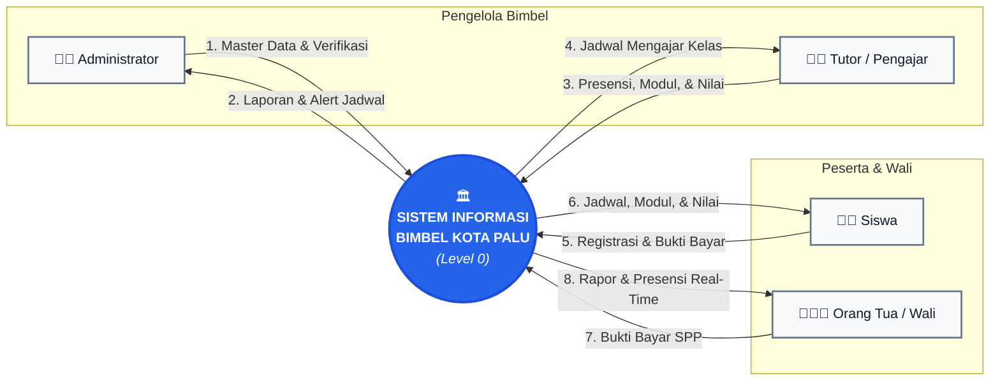
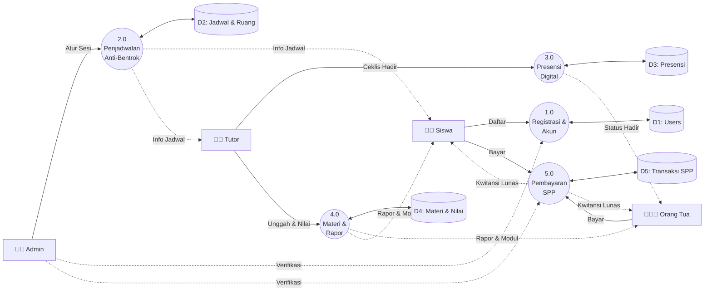
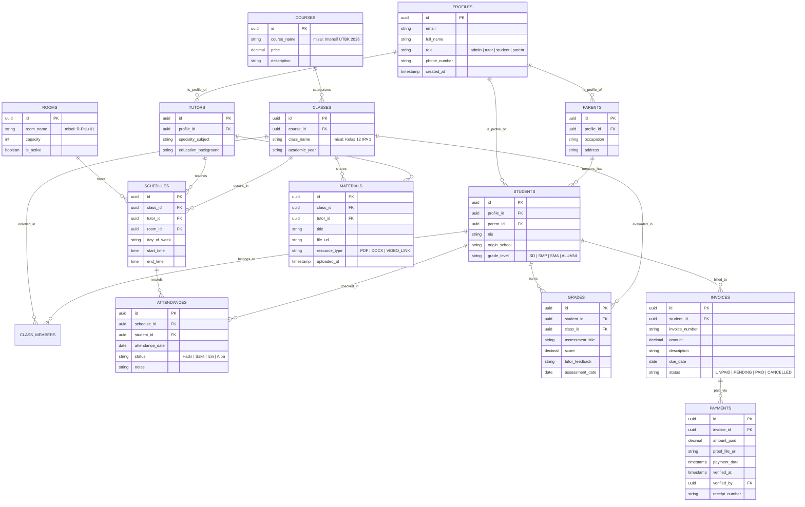
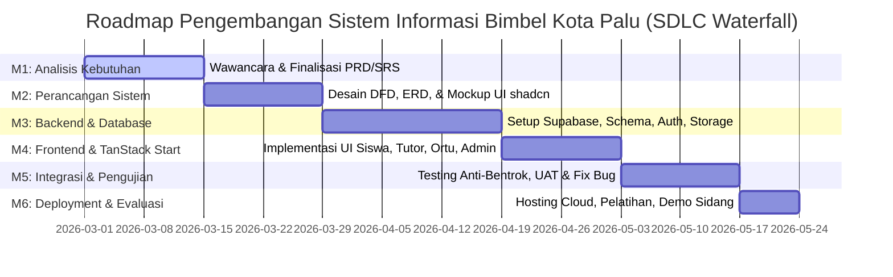

# Product Requirements Document (PRD)

## Sistem Informasi Bimbingan Belajar Berbasis Web untuk Mendukung Pembelajaran di Kota Palu

---

### Informasi Dokumen

- **Nama Proyek**: Sistem Informasi Bimbingan Belajar (Bimbel) Berbasis Web
- **Mata Kuliah**: Rekayasa Perangkat Lunak (RPL)
- **Institusi**: Program Studi S1 Teknik Informatika, Fakultas Teknik, Universitas Tadulako, Palu
- **Penyusun**: Kelompok 3 (Lidiya - F5512530118, Winda Tesalonika - F5512520088, Moh. Yusfi - F5512520089)
- **Tahun Akademik**: 2026
- **Model Pengembangan**: SDLC Waterfall (12 Minggu)
- **Status Dokumen**: Approved &amp; Baseline v1.0

---

## 1. Ringkasan Eksekutif &amp; Latar Belakang

### 1.1 Konteks Masalah di Kota Palu

Di Kota Palu, mayoritas operasional lembaga bimbingan belajar (bimbel) masih dikelola secara manual atau semi-manual:

1. Pendaftaran siswa dicatat manual di buku besar, menyulitkan pencarian arsip dan rentan hilang.
2. Penjadwalan les diatur manual melalui grup percakapan (WhatsApp), sering mengakibatkan **jadwal bentrok** antartutor maupun perebutan ruang belajar fisik.
3. Distribusi modul materi pelajaran masih mengandalkan fotokopi fisik atau tautan yang tersebar tanpa dokumentasi terpusat.
4. Orang tua kesulitan memantau kehadiran siswa secara *real-time* (apakah anak benar-benar hadir les atau membolos) serta tidak memiliki akses transparan ke perkembangan nilai belajar.
5. Rekap tagihan dan pencatatan pembayaran SPP les masih manual, rawan *human error* dan kehilangan bukti transfer.

### 1.2 Tujuan Produk

Membangun platform sistem informasi berbasis web terpadu (*single-tenant*) untuk satu lembaga bimbingan belajar di Kota Palu yang menghubungkan seluruh siklus operasional: **pendaftaran mandiri**, **penjadwalan kelas anti-bentrok**, **distribusi materi digital**, **presensi kelas digital**, **rapor evaluasi progres belajar**, dan **verifikasi pembayaran SPP** secara transparan.

---

## 2. Arsitektur Teknologi &amp; Tech Stack

Sistem dibangun dengan standar arsitektur web modern full-stack:

- **Framework Web Full-stack**: [TanStack Start](https://tanstack.com/start) (React 19 SSR, Type-Safe Routing, Server Functions)
- **State Management &amp; Data Fetching**: [TanStack Query v5](https://tanstack.com/query)
- **Data Presentation &amp; Grid**: [TanStack Table v8](https://tanstack.com/table) (Filter, Sorting, Pagination data siswa, jadwal, nilai, dan transaksi)
- **Komponen UI**: [shadcn/ui](https://ui.shadcn.com/) berbasis Radix UI
- **Styling**: [Tailwind CSS v4](https://tailwindcss.com/)
- **Backend, Database &amp; Autentikasi**: [Supabase](https://supabase.com/)
  - **Database**: PostgreSQL (Relational Database dengan Indexing &amp; Foreign Keys)
  - **Autentikasi**: Supabase Auth (Email &amp; Password dengan Role-Based Access Control)
  - **Object Storage**: Supabase Storage Buckets (`receipts` untuk bukti bayar, `learning-materials` untuk modul PDF/tugas, `avatars` untuk foto profil)
  - **Realtime**: Supabase Realtime (In-App Notification &amp; Broadcast pengumuman)

---

## 3. Matriks Peran Pengguna (User Roles &amp; Permissions)

Sistem memiliki 4 aktor pengguna dengan hak akses terisolasi (RBAC):

| Peran (Role)         | Deskripsi Utama                               | Hak Akses Fitur                                                                                                                                                                                                                                                                      |
| :-------------------- | :--------------------------------------------- | :------------------------------------------------------------------------------------------------------------------------------------------------------------------------------------------------------------------------------------------------------------------------------------ |
| **Admin**            | Pengelola operasional &amp; tata usaha bimbel | - Kelola Master Data (Siswa, Tutor, Orang Tua, Ruangan, Mapel, Paket Bimbel) - Manajemen Jadwal Bimbingan (Anti-bentrok) - Verifikasi Pendaftaran Siswa Baru - Verifikasi Bukti Pembayaran SPP &amp; Terbitkan Kwitansi - Broadcast Pengumuman Resmi Bimbel              |
| **Tutor (Pengajar)** | Tenaga pendidik bimbingan belajar             | - Lihat Jadwal Mengajar Pribadi mingguan/harian - Presensi Digital Siswa per Sesi Kelas - Unggah Modul Pelajaran &amp; Lembar Tugas (PDF/Link) - Input Nilai Latihan/Try Out &amp; Catatan Progres Belajar Siswa                                                            |
| **Siswa**            | Peserta bimbingan belajar                     | - Akses Jadwal Sesi Les Pribadi - Unduh Modul Pembelajaran &amp; Lembar Tugas - Pantau Riwayat Kehadiran &amp; Rekap Nilai Pribadi - Lihat Status Tagihan Biaya Les &amp; Notifikasi Kelas                                                                                  |
| **Orang Tua**        | Wali/orang tua dari satu atau lebih siswa     | - *Child Switcher* (pilih profil anak jika memiliki &gt;1 anak di bimbel) - Pantau Kehadiran Anak *Real-Time* (Hadir/Sakit/Izin/Alpa) - Rapor Progres Nilai &amp; Catatan/Evaluasi dari Tutor - Portal Tagihan SPP: Unggah Bukti Transfer Bank &amp; Unduh Kwitansi Digital |

---

## 4. Kebutuhan Fungsional &amp; Kriteria Akseptasi (Spesifikasi Fitur)

### 4.1 Modul Autentikasi &amp; Manajemen Akun (AUTH)

- **AUTH-01: Registrasi Calon Siswa Mandiri**
  - *User Story*: Sebagai calon siswa/wali, saya ingin mendaftar secara daring lewat halaman registrasi web dengan mengisi data diri (Nama, Sekolah Asal, No HP/WA, Pilihan Paket Bimbel: SD/SMP/SMA/UTBK) agar tidak perlu mengantre di kantor bimbel.
  - *Acceptance Criteria*:
    - Calon siswa menerima status `Menunggu Verifikasi Admin`.
    - Sistem memvalidasi email unik dan format nomor telepon.
- **AUTH-02: Role-Based Dashboard Redirection**
  - *Acceptance Criteria*:
    - Setelah login sukses via Supabase Auth, sistem mengarahkan user secara otomatis ke rute dashboard sesuai role (`/admin`, `/tutor`, `/student`, `/parent`).

### 4.2 Modul Penjadwalan Bimbingan Anti-Bentrok (SCHED)

- **SCHED-01: Manajemen Master Ruangan &amp; Sesi Jam**
  - Admin dapat mendefinisikan daftar ruang kelas fisik (misal: Ruang Palu-1, Ruang Tadulako-2) dan kapasitas kursi.
- **SCHED-02: Conflict Detection Engine (Validasi Anti-Bentrok)**
  - *User Story*: Sebagai Admin, saya ingin sistem otomatis mencegah jadwal yang bentrok saat menetapkan sesi bimbingan agar tutor dan ruang kelas tidak tumpang tindih.
  - *Logika Sistem*:
    - Dua sesi kelas dikatakan **BENTROK RUANGAN** jika: `(Ruangan_A == Ruangan_B) DAN (Hari_A == Hari_B) DAN (JamMulai_A < JamSelesai_B) DAN (JamSelesai_A > JamMulai_B)`.
    - Dua sesi kelas dikatakan **BENTROK TUTOR** jika: `(Tutor_A == Tutor_B) DAN (Hari_A == Hari_B) DAN (JamMulai_A < JamSelesai_B) DAN (JamSelesai_A > JamMulai_B)`.
  - *Acceptance Criteria*:
    - Jika terjadi tabrakan waktu pada ruangan atau tutor yang sama, tombol simpan diblokir dan muncul peringatan error visual merah yang menjelaskan sesi jadwal mana yang bertabrakan.

### 4.3 Modul Presensi Kelas Digital (ATTEND)

- **ATTEND-01: Checklist Presensi oleh Tutor**
  - *User Story*: Sebagai Tutor, saat kelas dimulai, saya ingin mencentang daftar kehadiran siswa di web sesuai sesi hari ini agar pencatatan presensi akurat dan langsung tercatat di database.
  - *Acceptance Criteria*:
    - Tutor memilih status per siswa: `Hadir`, `Sakit`, `Izin`, `Alpa`.
    - Data presensi langsung meng-update persentase kehadiran siswa secara otomatis.
- **ATTEND-02: Riwayat Presensi Real-Time untuk Siswa &amp; Orang Tua**
  - *Acceptance Criteria*:
    - Halaman dashboard Siswa dan Orang Tua langsung menampilkan status kehadiran hari ini beserta total rekap (misal: Kehadiran 95%).

### 4.4 Modul Pembelajaran &amp; Rapor Progres (LEARN)

- **LEARN-01: Manajemen Modul &amp; Latihan Soal (Supabase Storage)**
  - Tutor dapat mengunggah berkas modul (PDF/DOCX/PPTX maks 20MB) atau mencantumkan tautan video edukasi (YouTube/Google Drive).
  - Siswa yang terdaftar di kelas bersangkutan dapat mengunduh berkas materi langsung dari storage bucket.
- **LEARN-02: Input Nilai &amp; Feedback Evaluasi Belajar**
  - *User Story*: Sebagai Tutor, saya ingin menginputkan nilai tugas, kuis, atau try out beserta catatan evaluasi kualitatif untuk setiap siswa agar progres siswa terpantau.
  - *Acceptance Criteria*:
    - Input terdiri dari: Mata Pelajaran, Judul Evaluasi (misal: "Try Out 1 UTBK Matematika"), Skor Nilai (0-100), dan Catatan Tutor (misal: *"Perlu perbanyak latihan trigonometri"*).
- **LEARN-03: Dashboard Rapor Progres Orang Tua**
  - Orang tua dapat melihat grafik tren nilai dan catatan perkembangan anak per mata pelajaran.

### 4.5 Modul Manajemen Pembayaran SPP (BILL)

- **BILL-01: Pembuatan Tagihan Les Otomatis / Manual oleh Admin**
  - Admin membuat tagihan biaya bimbingan untuk siswa (biaya pendaftaran, SPP bulanan, atau biaya paket intensif).
  - Status awal tagihan: `Belum Dibayar`.
- **BILL-02: Pengunggahan Bukti Transfer oleh Siswa / Orang Tua**
  - *User Story*: Sebagai Siswa atau Orang Tua, saya ingin mengunggah foto bukti struk transfer bank (JPG/PNG/PDF) agar pembayaran saya dapat diproses.
  - *Acceptance Criteria*:
    - Berkas tersimpan aman di Supabase Storage bucket `receipts`.
    - Status tagihan otomatis berubah menjadi `Menunggu Verifikasi Admin`.
- **BILL-03: Verifikasi Admin &amp; Kwitansi Digital**
  - Admin meninjau berkas bukti bayar. Admin dapat memilih:
    - `Disetujui`: Status tagihan menjadi `Lunas`, sistem mencatat timestamp verifikasi dan men-generate nomor kwitansi resmi.
    - `Ditolak`: Status kembali `Belum Dibayar` disertai alasan penolakan (misal: nominal transfer kurang / foto buram).
  - Siswa dan Orang Tua dapat mencetak/mengunduh kwitansi pembayaran digital berformat tanda lunas resmi.

### 4.6 Modul In-App Notification (NOTIF)

- Notifikasi lonceng pada antarmuka web untuk peristiwa penting:
  - Pembayaran diverifikasi / ditolak.
  - Sesi bimbingan dijadwalkan ulang atau materi baru diunggah oleh tutor.
  - Peringatan absensi Alpa untuk akun Orang Tua.

---

## 5. Diagram Alir Data (Data Flow Diagram / DFD)

### 5.1 Diagram Konteks (DFD Level 0)

Diagram Konteks menggambarkan batasan sistem (*system boundary*) dengan tata letak horizontal kiri-ke-kanan yang bebas dari garis tumpang tindih:

### 5.2 DFD Level 1 (Dekomposisi 5 Proses Utama)

Untuk menjaga keterbacaan tinggi dan menghindari garis silang (*spider-web*), DFD Level 1 disajikan melalui alur pipeline global:

*(Catatan: Rincian dekomposisi per modul proses 1.0 s/d 5.0 tersedia lengkap dan terisolasi pada berkas [dfd_level_1.md](file:///home/mint/project-tugas-untad/bimbel/dfd/dfd_level_1.md)).*

---

## 6. Perancangan Basis Data (Entity Relationship Diagram / ERD)

Skema relasional PostgreSQL di Supabase yang dirancang terintegrasi:

---

## 7. Kebutuhan Non-Fungsional (Non-Functional Requirements / NFR)

1. **Keamanan (Security)**:
   - Seluruh komunikasi web menggunakan protokol enkripsi HTTPS/TLS.
   - Isolasi data menggunakan PostgreSQL Row-Level Security (RLS) di Supabase:
     - Siswa hanya dapat membaca data miliknya sendiri.
     - Orang tua hanya dapat mengakses data siswa yang berelasi dengan `parent_id` miliknya.
     - Tutor hanya dapat menginput nilai/presensi pada kelas yang dia ajar.
     - Admin memiliki akses *full read-write*.
2. **Kinerja (Performance)**:
   - Pemanfaatan Server-Side Rendering (SSR) via TanStack Start memastikan waktu muat awal (*First Contentful Paint*) di bawah 1.5 detik pada koneksi internet standar Kota Palu.
   - TanStack Table dengan optimasi *server-side pagination* untuk menjaga kelancaran tampilan daftar ratusan siswa dan riwayat transaksi.
3. **Usabilitas &amp; Responsivitas (UI/UX)**:
   - Antarmuka responsif ramah seluler (*mobile-first*) menggunakan Tailwind CSS dan shadcn/ui sehingga orang tua dan siswa nyaman membuka sistem melalui smartphone.
4. **Keandalan &amp; Integritas Data (Data Integrity)**:
   - *Database constraint &amp; validation rule* menjamin tidak ada jadwal yang bentrok (*double booking*) pada ruang dan tutor yang sama.

---

## 8. Milestone &amp; Pemetaan SDLC Waterfall (12 Minggu)

Mengacu pada Bab IV dan Bab V laporan referensi proyek:

| Milestone             | Kegiatan Utama             | Durasi   | Luaran (Deliverables)                                         |
| :--------------------- | :-------------------------- | :-------- | :------------------------------------------------------------- |
| **M1** (Minggu 1-2)   | Analisis Kebutuhan         | 2 Minggu | Dokumen PRD / SRS final disetujui tim &amp; dosen             |
| **M2** (Minggu 3-4)   | Perancangan Sistem         | 2 Minggu | Diagram DFD Level 0 &amp; 1, Skema ERD, Wireframe UI          |
| **M3** (Minggu 5-7)   | Backend &amp; Database     | 3 Minggu | PostgreSQL DB Supabase, RLS Policy, Storage Buckets, Auth API |
| **M4** (Minggu 8-9)   | Frontend TanStack          | 2 Minggu | Halaman Web Responsif untuk 4 Peran Pengguna                  |
| **M5** (Minggu 10-11) | Integrasi &amp; Uji Sistem | 2 Minggu | Verifikasi Anti-bentrok, UAT, Black-box testing               |
| **M6** (Minggu 12)    | Deployment &amp; Evaluasi  | 1 Minggu | Aplikasi live di Vercel/Netlify, Buku Panduan Pengguna        |

---

## 9. Rekomendasi Berkas DFD Pendukung

Untuk mengisi folder `dfd/` dalam repositori Anda guna kebutuhan laporan tugas kuliah:

- `dfd/context_diagram.md`: Diagram Konteks beserta narasi aliran entitas.
- `dfd/dfd_level_1.md`: Rincian proses 1.0 s/d 5.0 beserta kamus data (*data dictionary*).
- `dfd/dfd_level_2.md`: Dekomposisi sub-proses detail (1.x s/d 5.x) bebas garis bertumpuk.