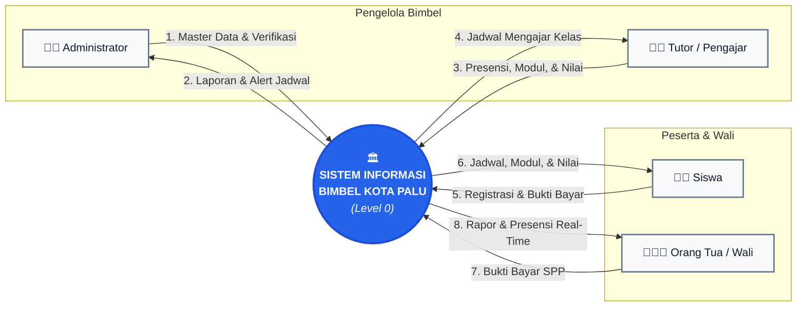

# Diagram Konteks (DFD Level 0) - Revisi Bersih
## Sistem Informasi Bimbingan Belajar Kota Palu

Diagram Konteks menggambarkan batasan sistem (*system boundary*) dan hubungan pertukaran informasi antara sistem dengan entitas luar.

---

### 1. Visualisasi Diagram Konteks (Layout Rapi & Bebas Garis Bertumpuk)

---

### 2. Penjelasan Aliran Data Berdasarkan Penomoran

Agar diagram tidak ruwet oleh teks panjang di panah, detail isi aliran data dirinci secara terstruktur pada tabel berikut:

| No. | Aliran Data | Dari | Ke | Rincian Informasi Data |
| :---: | :--- | :---: | :---: | :--- |
| **1** | **Master Data & Verifikasi** | Admin | Sistem | Data ruangan, data tutor, mata pelajaran, alokasi jadwal, persetujuan pendaftaran, dan verifikasi bayar. |
| **2** | **Laporan & Alert Jadwal** | Sistem | Admin | Notifikasi peringatan bentrok ruang/tutor, rekap kehadiran, dan rekapitulasi keuangan. |
| **3** | **Presensi, Modul, & Nilai** | Tutor | Sistem | Ceklis presensi harian siswa, upload file materi (PDF/link), dan input nilai tugas/try out. |
| **4** | **Jadwal Mengajar Kelas** | Sistem | Tutor | Kalender jadwal mengajar mingguan dan daftar siswa di tiap rombel kelas. |
| **5** | **Registrasi & Bukti Bayar** | Siswa | Sistem | Form pendaftaran mandiri (biodata, jenjang sekolah) dan upload foto struk transfer bank. |
| **6** | **Jadwal, Modul, & Nilai** | Sistem | Siswa | Kalender bimbingan belajar, unduh modul materi pelajaran, riwayat absensi, dan nilai tugas. |
| **7** | **Bukti Bayar SPP** | Orang Tua | Sistem | Unggah foto bukti transfer pelunasan biaya bimbingan les anak. |
| **8** | **Rapor & Presensi Real-Time** | Sistem | Orang Tua | Status kehadiran anak hari ini (*Hadir/Sakit/Izin/Alpa*), grafik rapor nilai, evaluasi tutor, dan kwitansi digital lunas. |
