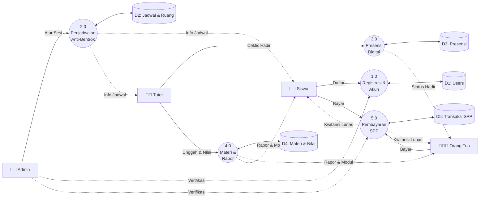
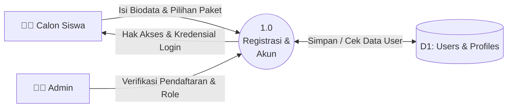
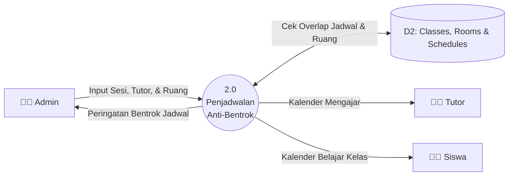
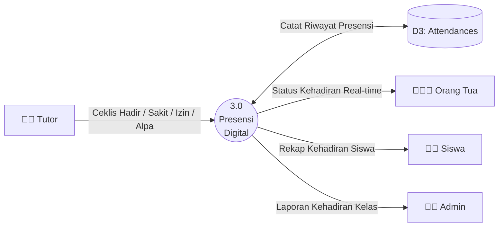
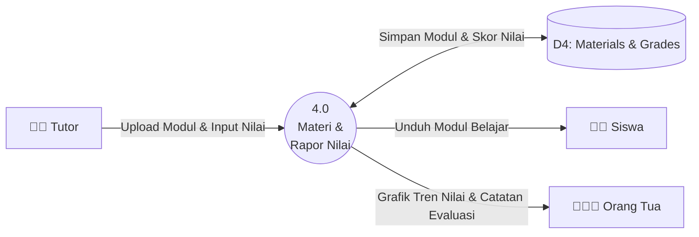
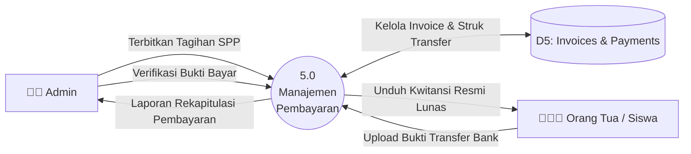

# Data Flow Diagram (DFD) Level 1 - Revisi Modular
## Sistem Informasi Bimbingan Belajar Kota Palu

DFD Level 1 mendekomposisi sistem menjadi **5 Proses Fungsional Utama**. Agar mudah dibaca dan tidak terjadi garis silang (*spider-web lines*), disajikan **Diagram Ikhtisar Global** diikuti oleh **Dekomposisi per Modul Proses**.

---

### 1. Diagram Ikhtisar Alur Kerja Global (Global Pipeline)

Diagram ini memperlihatkan perjalanan data operasional dari hulu (pendaftaran) hingga hilir (pembayaran & rapor):

---

### 2. Dekomposisi Terperinci per Proses (Bebas Garis Ruwet)

Berikut rincian masing-masing proses sehingga setiap alur masukan, proses, penyimpanan (*data store*), dan keluaran terlihat sangat jelas:

#### 2.1 Proses 1.0: Manajemen Registrasi & Akun Pengguna
Mengelola pendaftaran mandiri calon siswa, pembuatan akun wali, serta penentuan hak akses (*Role*).

---

#### 2.2 Proses 2.0: Penjadwalan Bimbingan & Ruang Anti-Bentrok
Mengelola master ruang kelas fisik dan jadwal bimbingan dengan validasi otomatis agar tidak ada ruang atau tutor yang bentrok di jam yang sama.

---

#### 2.3 Proses 3.0: Presensi Kelas Digital
Tutor mencatat kehadiran siswa saat sesi les berlangsung, yang langsung memperbarui persentase kehadiran dan dapat dilihat oleh orang tua secara *real-time*.

---

#### 2.4 Proses 4.0: Pembelajaran, Modul & Rapor Progres Nilai
Tutor mengunggah materi modul belajar (disimpan di Supabase Storage) dan menginputkan skor latihan/try out beserta catatan kualitatif evaluasi anak.

---

#### 2.5 Proses 5.0: Tagihan Biaya Les & Verifikasi Pembayaran SPP
Mengatur penerbitan tagihan, penerimaan bukti transfer bank, verifikasi oleh admin, dan penerbitan kwitansi digital lunas.

---

### 3. Pemetaan Data Store ke Tabel Basis Data

| Data Store | Nama Tabel Relasional | Deskripsi Isi Penyimpanan |
| :--- | :--- | :--- |
| **D1: Users** | `profiles`, `students`, `parents`, `tutors` | Akun, biodata, peran (RBAC), nomor kontak, sekolah asal. |
| **D2: Jadwal & Ruang**| `rooms`, `classes`, `schedules` | Ruang kelas fisik, kapasitas, jadwal hari/jam, relasi kelas & tutor. |
| **D3: Presensi** | `attendances` | Status kehadiran harian per sesi kelas (`Hadir`, `Sakit`, `Izin`, `Alpa`). |
| **D4: Materi & Nilai**| `materials`, `grades` | Berkas modul PDF di Supabase Storage, tautan video, nilai latihan & catatan evaluasi. |
| **D5: Transaksi SPP** | `invoices`, `payments` | Nomor tagihan, nominal, berkas struk bukti transfer, status lunas, nomor kwitansi. |
