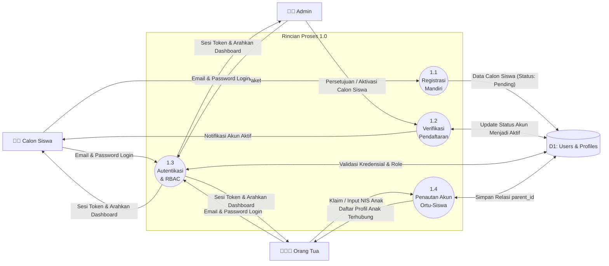
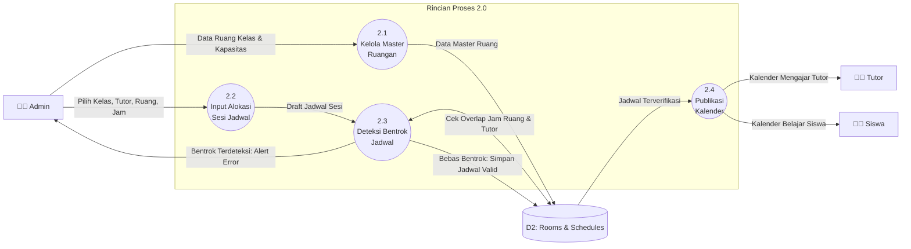
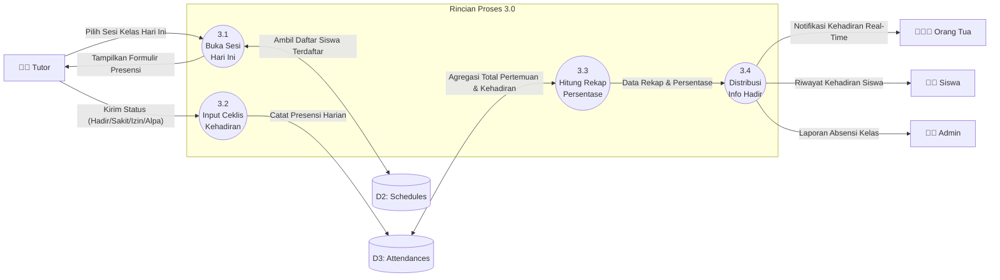
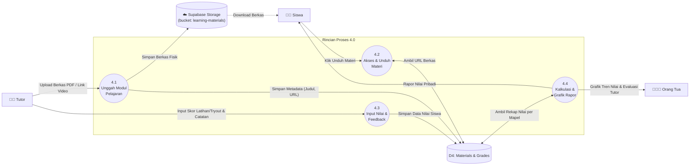
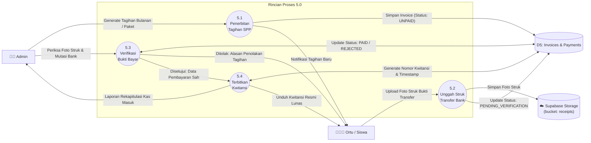

# Data Flow Diagram (DFD) Level 2
## Sistem Informasi Bimbingan Belajar Kota Palu

Dokumen ini membedah setiap proses utama dari DFD Level 1 menjadi sub-proses detail (Level 2). Setiap diagram disajikan secara modular dengan aliran data yang jelas, tidak ada garis bertumpuk, dan langsung mencerminkan alur teknis sistem.

---

## 1. DFD Level 2 - Proses 1.0 (Manajemen Registrasi & Akun)

Dekomposisi dari proses **1.0 Autentikasi & Akun** menangani alur pendaftaran siswa baru, verifikasi persetujuan admin, autentikasi sesi via Supabase Auth, dan relasi akun orang tua-anak.

### Kamus Data Sub-Proses 1.0:
* `1.1`: Input: `nama_lengkap`, `email`, `no_hp`, `asal_sekolah`, `jenjang (SD/SMP/SMA)`, `paket_bimbel`. Output: Calon siswa tersimpan dengan status *pending*.
* `1.2`: Admin mengubah status siswa menjadi *active*, sistem men-generate akun Supabase Auth.
* `1.3`: Validasi login berbasis role (`admin`, `tutor`, `student`, `parent`).
* `1.4`: Menghubungkan ID akun orang tua dengan satu atau beberapa ID siswa (*multi-child switcher*).

---

## 2. DFD Level 2 - Proses 2.0 (Penjadwalan Bimbingan & Ruang Anti-Bentrok)

Dekomposisi dari proses **2.0 Penjadwalan** memperlihatkan logika deteksi bentrok ruang dan bentrok tutor (*conflict engine*).

### Kamus Data Sub-Proses 2.0:
* `2.1`: Input data fisik ruang: `nama_ruang`, `kapasitas_kursi`, `fasilitas`.
* `2.2`: Admin menyusun draft: `id_kelas`, `id_tutor`, `id_ruang`, `hari`, `jam_mulai`, `jam_selesai`.
* `2.3`: Algoritma deteksi bentrok:
  * Ruang sama pada irisan jam: `JamMulai_Baru < JamSelesai_Lama AND JamSelesai_Baru > JamMulai_Lama`.
  * Tutor sama pada irisan jam: `JamMulai_Baru < JamSelesai_Lama AND JamSelesai_Baru > JamMulai_Lama`.
* `2.4`: Jadwal yang lolos validasi otomatis tampil pada kalender web masing-masing pengguna.

---

## 3. DFD Level 2 - Proses 3.0 (Presensi Kelas Digital)

Dekomposisi dari proses **3.0 Presensi Digital** menunjukkan alur pencatatan kehadiran oleh pengajar hingga sampai ke orang tua secara *real-time*.

### Kamus Data Sub-Proses 3.0:
* `3.1`: Mengambil data rombel siswa sesuai `id_jadwal` yang sedang aktif pada tanggal berjalan.
* `3.2`: Input data presensi: `id_jadwal`, `id_siswa`, `tanggal`, `status (H/S/I/A)`, `catatan_keterangan`.
* `3.3`: Rumus persentase kehadiran: `(Total Hadir / Total Sesi Berlangsung) * 100%`.
* `3.4`: Output ke dashboard orang tua: status kehadiran hari ini dan peringatan jika anak Alpa.

---

## 4. DFD Level 2 - Proses 4.0 (Pembelajaran, Modul & Evaluasi Nilai)

Dekomposisi dari proses **4.0 Modul & Nilai** menunjukkan integrasi berkas modul dengan Supabase Storage dan penyusunan rapor nilai progres belajar.

### Kamus Data Sub-Proses 4.0:
* `4.1`: Berkas fisik modul disimpan di Supabase Storage; metadata disimpan di database: `id_kelas`, `id_tutor`, `judul_materi`, `file_url`, `tipe_berkas`.
* `4.2`: Siswa mengunduh berkas materi sesuai kelas yang diikutinya.
* `4.3`: Input evaluasi: `id_siswa`, `id_kelas`, `mata_pelajaran`, `judul_evaluasi`, `skor (0-100)`, `catatan_kualitatif_tutor`.
* `4.4`: Kalkulasi rata-rata skor nilai dan visualisasi tren progres belajar siswa untuk dipantau orang tua.

---

## 5. DFD Level 2 - Proses 5.0 (Tagihan & Pembayaran SPP)

Dekomposisi dari proses **5.0 Manajemen Pembayaran** memperlihatkan alur penagihan, upload struk bank ke Supabase Storage, verifikasi admin, dan penerbitan kwitansi digital.

### Kamus Data Sub-Proses 5.0:
* `5.1`: Admin menerbitkan invoice: `id_siswa`, `nomor_invoice`, `nominal`, `keterangan_periode`, `jatuh_tempo`, `status: UNPAID`.
* `5.2`: Wali/Siswa mengunggah foto struk bukti bayar ke Supabase Storage bucket `receipts`, mencatat `tanggal_transfer`, dan mengubah status invoice menjadi `PENDING_VERIFICATION`.
* `5.3`: Admin memeriksa kecocokan nominal transfer:
  * Jika tidak sesuai/buram: status kembali ke `UNPAID` disertai `catatan_penolakan`.
  * Jika sesuai: status berubah menjadi `PAID`, dicatat `verified_by` dan `verified_at`.
* `5.4`: Sistem menerbitkan kwitansi resmi digital berformat PDF (*receipt*) dengan nomor unik untuk diunduh oleh orang tua/siswa, serta mengagregasi pemasukan ke laporan kas admin.
