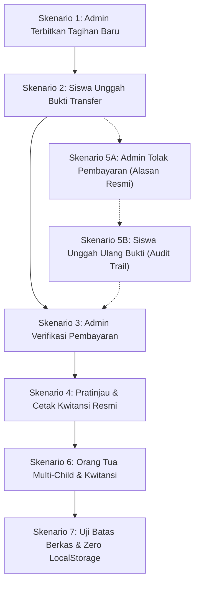

# Panduan Pengujian Manual — Tagihan SPP, Bukti Bayar & Kwitansi Resmi (Tiket 06)

Dokumen ini adalah panduan langkah-demi-langkah pengujian manual fitur **Tagihan SPP, Bukti Bayar & Penerbitan Kwitansi Resmi (Tiket 06)** pada Sistem Informasi Bimbingan Belajar Tadulako Cendekia.

---

## 1. Prasyarat & Lingkungan Uji

### 1.1 Menjalankan Server Aplikasi
Jalankan aplikasi di terminal lokal:
```bash
npm run dev
```
Buka browser di alamat: `http://localhost:5173` (atau port aktif yang ditampilkan di terminal).

### 1.2 Kredensial Akun Pengujian
Gunakan akun uji coba resmi dari master data (dapat dipilih langsung via tombol cepat di halaman `/masuk`):

| Peran | Akun Email | Sandi | Nama Pengguna | Catatan / Sasaran |
|---|---|---|---|---|
| **Admin (Tata Usaha)** | `nuraini.tu@tadulakocendekia.sch.id` | `password123` | Hj. Nuraini, S.Pd | Pengelola tagihan & verifikasi pembayaran |
| **Siswa** | `fahri.ramadhan@siswa.tadulakocendekia.sch.id` | `password123` | Fahri Ramadhan | Siswa aktif (NIS: 20261001), kelas UTBK Intensif |
| **Orang Tua / Wali** | `ahmad.dahlan@wali.tadulakocendekia.sch.id` | `password123` | Ir. H. Ahmad Dahlan | Wali murid dari Fahri Ramadhan & Fajar Ramadhan |

---

## 2. Skenario Pengujian Berurutan



---

### Skenario 1: Penerbitan Tagihan Baru oleh Admin
**Tujuan**: Memastikan Admin dapat menerbitkan tagihan SPP baru yang tersimpan langsung di database PostgreSQL Supabase dengan penomoran unik berformat `INV-YYYYMM-XXXX`.

**Langkah Pengujian**:
1. Masuk ke halaman `/masuk` dan pilih profil **Admin / Tata Usaha (Hj. Nuraini, S.Pd)**.
2. Buka menu **Pembayaran SPP** di sidebar atau navigasi langsung ke `/admin/pembayaran`.
3. Klik tombol **Terbitkan Tagihan**.
4. Isi formulir penerbitan:
   - **Pilih Siswa**: `Fahri Ramadhan (NIS: 20261001)`
   - **Program / Deskripsi**: `SPP Bulan Berjalan - Intensif UTBK-SNBT`
   - **Nominal Tagihan**: `450000` (atau nominal sesuai kebutuhan)
   - **Jatuh Tempo**: Tentukan tanggal di masa mendatang
5. Klik **Simpan & Terbitkan Tagihan**.

**Hasil yang Diharapkan**:
- Muncul konfirmasi bahwa tagihan berhasil diterbitkan.
- Tagihan baru muncul pada baris teratas daftar tagihan dengan nomor `INV-YYYYMM-XXXX`.
- Status tagihan bertuliskan `Belum dibayar` (indikator inline text abu-abu/kuning dengan icon resmi).
- Data langsung tersimpan di tabel `invoices` PostgreSQL Supabase.

---

### Skenario 2: Siswa Mengunggah Bukti Bayar
**Tujuan**: Memastikan Siswa dapat melihat tagihan miliknya dan mengunggah berkas bukti transfer ke Supabase Storage `receipts`.

**Langkah Pengujian**:
1. Masuk ke `/masuk` dan pilih profil **Siswa (Fahri Ramadhan)**.
2. Buka menu **Tagihan SPP** di sidebar atau navigasi ke `/student/tagihan`.
3. Periksa tagihan yang baru diterbitkan pada Skenario 1 (contoh: `INV-202610-0013`).
4. Klik tombol **Unggah Bukti Transfer** pada baris tagihan tersebut.
5. Pada modal formulir unggah bukti:
   - Pilih berkas gambar transfer bank (format JPG atau PNG, ukuran < 5MB).
   - Isi **Nama Bank / Saluran Pengirim** (contoh: `BCA`, `BRI`, atau `Bank Sulteng`).
   - Isi **Nama Pengirim / Catatan** (opsional).
6. Klik tombol **Unggah Bukti Bayar**.

**Hasil yang Diharapkan**:
- Berkas terunggah ke bucket storage `receipts` Supabase.
- Satu rekaman pembayaran baru dibuat di tabel `payments` dengan status `menunggu`.
- Status tagihan di halaman siswa seketika berubah menjadi `Menunggu Verifikasi`.
- Tombol aksi berubah menjadi `Periksa Bukti / Status`.

---

### Skenario 3: Admin Memverifikasi Pembayaran & Penerbitan Kwitansi
**Tujuan**: Memastikan Admin dapat meninjau bukti transfer yang diunggah siswa, menyetujui verifikasi, dan sistem otomatis menerbitkan nomor kwitansi sah `KWT-YYYYMM-XXXX`.

**Langkah Pengujian**:
1. Masuk kembali sebagai **Admin / Tata Usaha (Hj. Nuraini, S.Pd)** di `/admin/pembayaran`.
2. Klik tab filter **Menunggu Verifikasi**.
3. Temukan baris tagihan siswa yang baru saja diunggah buktinya.
4. Klik tombol **Periksa Bukti**.
5. Modal pratinjau bukti bayar akan menampilkan gambar struk transfer, nama bank pengirim, dan waktu transfer.
6. Klik tombol **Verifikasi Lunas**.
7. Konfirmasi aksi pada dialog yang muncul.

**Hasil yang Diharapkan**:
- Status tagihan berubah menjadi `Lunas` (indikator teks hijau dengan icon `CheckCircle2`).
- Sistem otomatis mengisikan nomor kwitansi dengan pola `KWT-YYYYMM-XXXX`.
- Kolom tanggal verifikasi dan nama verifikator tercatat secara permanen di database.

---

### Skenario 4: Pratinjau & Cetak Kwitansi Resmi Digital
**Tujuan**: Memastikan siswa dan orang tua dapat membuka serta mencetak dokumen kwitansi digital resmi berstempel Tadulako Cendekia.

**Langkah Pengujian**:
1. Masuk sebagai **Siswa (Fahri Ramadhan)** di `/student/tagihan` (atau sebagai Admin di `/admin/pembayaran`).
2. Temukan tagihan berstatus `Lunas`.
3. Klik tombol **Lihat Kwitansi**.
4. Periksa komponen pada jendela Kwitansi Resmi:
   - Kop resmi Bimbingan Belajar Tadulako Cendekia Palu.
   - Nomor Invoice (`INV-YYYYMM-XXXX`) dan Nomor Kwitansi (`KWT-YYYYMM-XXXX`).
   - Identitas lengkap Siswa (Nama, NIS, Program Bimbingan).
   - Rincian nominal terbayar dan tanggal pelunasan.
   - Stempel sah Tadulako Cendekia dan tanda tangan digital Tata Usaha.
5. Klik tombol **Cetak Kwitansi**.

**Hasil yang Diharapkan**:
- Jendela dialog cetak browser (`window.print`) terbuka dengan tata letak kwitansi rapi siap cetak atau simpan PDF.

---

### Skenario 5: Alur Penolakan Bukti Bayar & Pengunggahan Ulang (Audit Trail)
**Tujuan**: Memastikan alur penolakan bukti bayar tidak valid berjalan transparan dengan pencatatan alasan resmi dan riwayat audit trail lengkap.

**Langkah Pengujian**:
1. Terbitkan tagihan uji coba baru atau gunakan tagihan dengan bukti transfer yang belum diverifikasi.
2. Masuk sebagai Admin di `/admin/pembayaran`.
3. Klik **Periksa Bukti** pada tagihan berstatus `Menunggu Verifikasi`.
4. Klik tombol **Tolak Pembayaran**.
5. Masukkan alasan penolakan secara jelas pada kolom input (contoh: `Nominal transfer kurang Rp 50.000` atau `Bukti transfer buram tidak terbaca`).
6. Klik **Konfirmasi Penolakan**.
7. Buka portal siswa di `/student/tagihan`:
   - Amati status tagihan berubah menjadi `Ditolak` (indikator teks merah).
   - Alasan penolakan dari admin ditampilkan secara jelas kepada siswa.
8. Siswa mengklik **Unggah Ulang Bukti Transfer** dan mengunggah gambar bukti yang benar.
9. Simpan bukti baru.

**Hasil yang Diharapkan**:
- Status tagihan kembali beralih ke `Menunggu Verifikasi`.
- Pada tabel `payments`, bukti lama berstatus `ditolak` tetap tersimpan sebagai rekam jejak (audit trail), dan bukti baru tersimpan dengan status `menunggu`. Tidak ada data riwayat yang terhapus atau tertimpa.

---

### Skenario 6: Portal Orang Tua & Isolasi Multi-Child
**Tujuan**: Memastikan Orang Tua dengan banyak anak dapat beralih akun anak secara mandiri dan memantau tagihan serta kwitansi masing-masing anak secara terisolasi.

**Langkah Pengujian**:
1. Masuk sebagai **Orang Tua / Wali (Ir. H. Ahmad Dahlan)**.
2. Buka menu **Tagihan SPP** di `/parent/tagihan`.
3. Periksa panel pemilih anak (child switcher):
   - Pilih **Fahri Ramadhan**: tagihan yang muncul adalah tagihan khusus Fahri.
   - Pilih **Fajar Ramadhan**: tagihan yang muncul adalah tagihan khusus Fajar.
4. Pada anak terpilih, Orang Tua dapat:
   - Mengunggah bukti bayar atas nama orang tua/wali.
   - Mengunduh / melihat kwitansi resmi dari tagihan yang telah lunas.

**Hasil yang Diharapkan**:
- Data tagihan terisolasi penuh sesuai anak yang sedang aktif dipilih.
- Tidak ada percampuran data invoice antar saudara kandung.

---

### Skenario 7: Uji Batas Berkas (Edge Cases) & Pembuktian Zero LocalStorage
**Tujuan**: Memastikan sistem menolak berkas tidak valid dan membuktikan bahwa seluruh data transaksi tersimpan murni di database Supabase tanpa bergantung pada fallback localStorage.

**Langkah Pengujian**:
1. **Uji Format Berkas**:
   - Coba unggah berkas bukan gambar (misal: berkas `.txt` atau `.pdf`) pada formulir bukti bayar.
   - Ekspektasi: Sistem menolak berkas dan menampilkan pesan validasi `Format berkas harus JPG, JPEG, atau PNG`.
2. **Uji Batas Ukuran Berkas**:
   - Coba unggah gambar dengan ukuran di atas 5MB.
   - Ekspektasi: Sistem menolak berkas dan menampilkan pesan `Ukuran berkas tidak boleh melebihi 5MB`.
3. **Pembuktian Zero LocalStorage**:
   - Buka browser Developer Tools (`F12` atau `Ctrl+Shift+I`).
   - Buka tab **Application** -> **Storage** -> **Local Storage** -> `http://localhost:5173`.
   - Periksa seluruh key-value di Local Storage:
     - Hanya boleh ada kunci autentikasi sesi Supabase (`tc_bimbel_supabase_auth_token` / `tc_auth_user`).
     - Kunci data tagihan legacy (`tc_invoices`, `tc_payments`, `tc_receipts`) sudah tidak ada dan tidak pernah dibuat lagi.
   - Lakukan refresh halaman (`F5`): seluruh data tagihan, status verifikasi, dan riwayat kwitansi tetap utuh bersumber dari PostgreSQL Supabase.

---

## 3. Matriks Checklist Verifikasi Manual (Test Matrix)

| ID Uji | Fitur / Skenario | Aksi Pengguna | Kriteria Kelulusan | Status |
|---|---|---|---|---|
| **TC-BILL-01** | Penerbitan Tagihan | Admin membuat tagihan baru untuk siswa Fahri Ramadhan | Nomor `INV-YYYYMM-XXXX` terbit, status `Belum dibayar`, data tersimpan di Supabase | [PASS] |
| **TC-BILL-02** | Unggah Bukti Bayar | Siswa mengunggah gambar bukti transfer di `/student/tagihan` | Berkas masuk bucket `receipts`, status tagihan beralih ke `Menunggu Verifikasi` | [PASS] |
| **TC-BILL-03** | Verifikasi Lunas | Admin meninjau bukti dan menekan tombol Verifikasi Lunas | Status beralih ke `Lunas`, otomatis terbit nomor kwitansi `KWT-YYYYMM-XXXX` | [PASS] |
| **TC-BILL-04** | Cetak Kwitansi | Siswa/Wali membuka kwitansi dan klik Cetak | Kwitansi resmi berstempel tampil rapi dan jendela cetak browser aktif | [PASS] |
| **TC-BILL-05** | Penolakan & Upload Ulang | Admin menolak dengan alasan, siswa mengunggah ulang bukti | Status `Ditolak` menampilkan catatan admin, saat diunggah ulang riwayat lama tetap ada (audit trail) | [PASS] |
| **TC-BILL-06** | Multi-Child Wali | Wali murid beralih anak di `/parent/tagihan` | Tagihan berganti sesuai anak yang dipilih secara terisolasi tanpa tercampur | [PASS] |
| **TC-BILL-07** | Validasi & Zero LocalStorage | Unggah berkas tidak valid & periksa Local Storage browser | Berkas dilarang ditolak sistem, data tagihan 100% dari Supabase tanpa localStorage | [PASS] |

---

## 4. Kesimpulan & Status Kesiapan
Fitur **Tagihan SPP, Bukti Bayar & Penerbitan Kwitansi Resmi (Tiket 06)** telah terverifikasi secara fungsional melalui seluruh pengujian manual di atas dan pengujian otomatis Vitest (288/288 unit & integration tests lulus). Sistem siap diserahkan untuk pengujian penerimaan pengguna (UAT) dan penggabungan ke branch utama.
