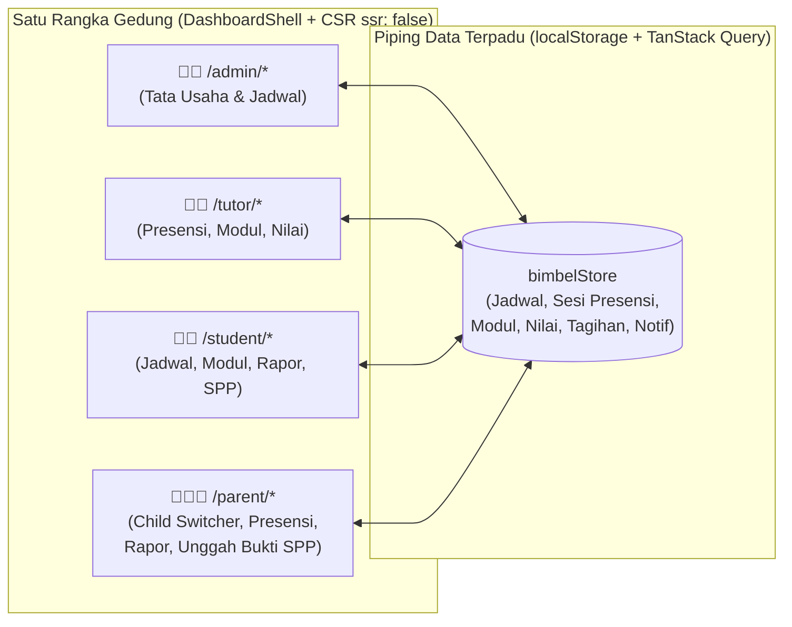

# Rencana Implementasi: Redesign Dashboard Siswa + Pembuatan Dashboard Tutor & Orang Tua

## Goal Description

Merombak total **Dashboard Siswa (`/student/*`)** agar seragam dengan tema **Poster Kontras Tinggi** ([`DESIGN.md`](file:///home/mint/orca/workspaces/bimbel/siswa/DESIGN.md) & fondasi Dashboard Admin di branch `mohyusfi/review-prd`), memperbaiki bug layout & tabel yang berantakan, serta membangun **Dashboard Tutor (`/tutor/*`)** dan **Dashboard Orang Tua (`/parent/*`)** lengkap sesuai spesifikasi [`PRD.md`](file:///home/mint/orca/workspaces/bimbel/siswa/PRD.md).

> [!NOTE]
> **Analogi Arsitektur:** Bayangkan keempat portal (`Admin`, `Tutor`, `Siswa`, `Orang Tua`) sebagai **4 ruangan di dalam satu gedung yang sama**. Semuanya memakai rangka bangunan yang sama (`DashboardShell`), perabot tabel & kartu yang sama (`DataTable`, `SummaryMetricCard`, `StatusBadge`), dan tersambung ke satu pipa data pusat (`bimbelStore` + TanStack Query). Saat Tutor mengabsen siswa atau menginput nilai di ruangannya, layar Siswa dan Orang Tua otomatis ikut ter-update detik itu juga.



---

## User Review Required

> [!IMPORTANT]
> **Keputusan Arsitektur Hasil Diskusi (Sudah Disepakati di Ronde 1):**
> 1. **Konsolidasi Git (Q1):** Perubahan Dashboard Admin yang belum di-commit pada worktree [`limpet`](file:///home/mint/orca/workspaces/bimbel/limpet) (`mohyusfi/review-prd`) akan di-commit terlebih dahulu, lalu di-merge ke branch `mohyusfi/siswa` sebagai fondasi utama.
> 2. **Akar Masalah Visual Siswa Diperbaiki (Q2 & Q3):**
>    - [`__root.tsx`](file:///home/mint/orca/workspaces/bimbel/siswa/src/routes/__root.tsx) tidak lagi memasang `<body class="landing">` di rute dashboard.
>    - [`globals.css`](file:///home/mint/orca/workspaces/bimbel/siswa/src/styles/globals.css) memuat `styles.css` di dalam `layer(base)` dan `landing.css` di `layer(components)` beserta blok `@theme` (`Archivo` + `Instrument Sans`), sehingga class Tailwind tidak lagi dikalahkan oleh CSS warisan.
>    - Seluruh kartu permukaan dashboard menggunakan gaya **datar (flat)** dengan `border: 1px solid #D2D2D2`, latar `#FFFFFF` di atas kanvas `#EEEEEE`, radius `6–14px`, tanpa bayangan mengambang (shadow hanya untuk modal/drawer). Kontradiksi pada `DESIGN.md` bagian 4.6 vs 11.3 akan diselaraskan.
> 3. **Satu `DashboardShell` Generik (Q4):** Менggantikan `StudentSidebar` + `StudentHeader` yang terpisah dan mengekstrak pola [`AdminShell.tsx`](file:///home/mint/orca/workspaces/bimbel/limpet/src/components/dashboard/AdminShell.tsx) menjadi `DashboardShell` lintas-peran (mendukung grup navigasi per role, notifikasi drawer, switcher anak khusus Orang Tua, dan switcher akun demo).
> 4. **Satu Data Store Reaktif Lintas-Role (Q5, Q7, Q8, Q9):**
>    - Memperluas [`admin-store.ts`](file:///home/mint/orca/workspaces/bimbel/limpet/src/lib/admin-store.ts) menjadi store terpadu yang menyimpan **Jadwal** (slot mingguan berulang), **Sesi** (pertemuan pada tanggal tertentu tempat melekatnya presensi `Hadir`/`Sakit`/`Izin`/`Alpa`), **Modul Materi**, **Nilai & Catatan Rapor**, serta **Tagihan SPP**.
>    - Status Tagihan diseragamkan: **Belum Dibayar (`belum_dibayar`) → Menunggu Verifikasi (`menunggu`) → Lunas (`lunas`)**, ditambah **Dibatalkan (`dibatalkan`)**. Jika ditolak Admin, status kembali ke **Belum Dibayar** disertai alasan penolakan (`rejectedReason`) dan pengunggah dapat mengunggah ulang.
>    - Pengunggahan bukti bayar (`BILL-02`) dapat dilakukan oleh Siswa maupun Orang Tua. Begitu salah satu mengunggah, status menjadi `Menunggu Verifikasi`, tombol unggah terkunci, dan tercatat metadata `submittedBy` (*"Diunggah oleh Ir. H. Ahmad Dahlan"* atau *"Fahri Ramadhan"*).
> 5. **Tabel Responsif Ramah HP (Q10):** Komponen [`DataTable`](file:///home/mint/orca/workspaces/bimbel/limpet/src/components/ui/data-table.tsx) ditingkatkan agar mendukung prop opsional `renderMobileCard={(row) => ...}`: di layar desktop tampil sebagai tabel penuh yang rapi (`tabular-nums`, header sentence-case), sedangkan di layar HP (`< md`) otomatis beralih menjadi daftar kartu yang nyaman dibaca tanpa geser horizontal paksa.

---

## Open Questions

> [!NOTE]
> Empat detail di bawah ini sudah memiliki **rekomendasi default** yang langsung siap dieksekusi jika Anda menekan **Proceed** (atau silakan beri catatan jika ingin diubah):
> 1. **Struktur Rute Tutor (`/tutor/*`):**
>    - *Rekomendasi:* 5 menu terfokus sesuai PRD: `/tutor` (Ringkasan & Sesi Aktif Hari Ini), `/tutor/jadwal` (Jadwal Mengajar Mingguan), `/tutor/presensi` (Checklist Presensi Sesi `ATTEND-01`), `/tutor/materi` (Unggah & Kelola Modul `LEARN-01`), dan `/tutor/nilai` (Input Nilai & Catatan Evaluasi `LEARN-02`).
> 2. **Struktur Rute Orang Tua (`/parent/*`) & Child Switcher:**
>    - *Rekomendasi:* 4 menu sesuai PRD: `/parent` (Ringkasan & Status Kehadiran Anak Hari Ini), `/parent/kehadiran` (Riwayat Presensi & Rekap Kehadiran `ATTEND-02`), `/parent/rapor` (Grafik Tren Nilai & Catatan Evaluasi Tutor `LEARN-03`), dan `/parent/tagihan` (Portal Tagihan SPP, Unggah Bukti Transfer & Cetak Kwitansi `BILL-02`/`BILL-03`).
>    - *Child Switcher:* Dipasang permanen di bagian atas konten dan sidebar Portal Orang Tua (dengan 2 anak pada akun demo: **Fahri Ramadhan — Kelas 12 SMA/UTBK** dan **Alya Ramadhani — Kelas 8 SMP**) sehingga saat wali berpindah anak, seluruh halaman otomatis menampilkan data anak tersebut.
> 3. **Aturan Edit Presensi Tutor:**
>    - *Rekomendasi:* Tutor dapat memilih sesi aktif hari ini maupun sesi pertemuan sebelumnya pada kelas yang iaampu, mengubah status (`Hadir` / `Sakit` / `Izin` / `Alpa`) dengan tombol cepat *"Tandai Semua Hadir"*, lalu menekan **Simpan Presensi Sesi** (yang otomatis memperbarui persentase kehadiran siswa & mengirim notifikasi ke Orang Tua bila ada status `Alpa`).
> 4. **Visualisasi Grafik Tren Nilai (`LEARN-03`):**
>    - *Rekomendasi:* Menggunakan grafik batang/garis SVG murni bergaya editorial (`#000000` & `#CB2957`, angka `tabular-nums`, tanpa library chart berat) yang menampilkan perkembangan skor per mata pelajaran dari waktu ke waktu.

---

## Proposed Changes

### 1. Kamus Domain (`CONTEXT.md`) & Penyelarasan `DESIGN.md`

Mendokumentasikan istilah baku proyek sesuai skill `domain-modeling` dan menghapus kontradiksi spesifikasi shadow kartu pada `DESIGN.md`.

#### [NEW] [CONTEXT.md](file:///home/mint/orca/workspaces/bimbel/siswa/CONTEXT.md)
- Mendefinisikan istilah domain secara ketat:
  - **Jadwal (`Schedule`)**: Slot waktu belajar mingguan yang berulang pada hari, jam, ruangan, kelas, dan tutor tertentu.
  - **Sesi (`Session`)**: Satu kali pertemuan aktual dari suatu **Jadwal** pada tanggal kalender tertentu tempat pencatatan **Presensi**.
  - **Presensi (`Attendance`)**: Status kehadiran siswa (`Hadir`, `Sakit`, `Izin`, `Alpa`) pada satu **Sesi**.
  - **Kelas / Rombel (`ClassGroup`)**: Kelompok belajar siswa dalam satu **Program / Paket Bimbel** (maksimal 12 siswa).
  - **Modul (`Material`)**: Berkas materi pembelajaran (PDF/DOCX) atau tautan video yang dibagikan Tutor kepada suatu **Kelas**.
  - **Evaluasi (`GradeRecord`)**: Nilai numerik (0–100) beserta catatan kualitatif dari Tutor untuk satu Siswa.
  - **Tagihan SPP (`Invoice`)**: Kewajiban pembayaran biaya bimbingan siswa dengan siklus status: `Belum Dibayar`, `Menunggu Verifikasi`, `Lunas`, atau `Dibatalkan`.
  - **Kwitansi (`Receipt`)**: Tanda bukti lunas resmi bernomor unik (`KWT-...`) yang diterbitkan setelah Admin memverifikasi bukti pembayaran.

#### [MODIFY] [DESIGN.md](file:///home/mint/orca/workspaces/bimbel/siswa/DESIGN.md)
- Menyelaraskan bagian **4.6** dengan bagian **11.3**: menegaskan bahwa kartu di dalam dashboard menggunakan permukaan datar (`#FFFFFF`) dengan `border: 1px solid #D2D2D2` tanpa shadow mengambang (`shadow-none`), sedangkan shadow halus/tegas hanya dipakai pada elemen melayang (Modal Dialog, Slide-over Drawer, Popover).

---

### 2. Konsolidasi Git & Fondasi Root (`__root.tsx`, `globals.css`, `package.json`)

Menyatukan hasil kerja Dashboard Admin dari worktree `limpet` (`mohyusfi/review-prd`) ke branch `mohyusfi/siswa`.

#### [MODIFY] [package.json](file:///home/mint/orca/workspaces/bimbel/siswa/package.json)
- Memastikan dependensi `@tanstack/react-query`, `@tanstack/react-table`, `@base-ui/react`, dan script `"typecheck": "tsc --noEmit"` tersedia lengkap.

#### [MODIFY] [globals.css](file:///home/mint/orca/workspaces/bimbel/siswa/src/styles/globals.css)
- Menggunakan `@import "../../styles.css" layer(base);` dan `@import "../../landing.css" layer(components);` serta blok `@theme` (`--font-sans: 'Instrument Sans'`, `--font-display: 'Archivo'`) dan utility `.font-display` (`font-stretch: 84%`).

#### [MODIFY] [__root.tsx](file:///home/mint/orca/workspaces/bimbel/siswa/src/routes/__root.tsx)
- Membungkus aplikasi dengan `QueryClientProvider`.
- Hanya memberikan `className="landing"` pada `<body />` ketika `pathname === '/'`, sedangkan seluruh rute dashboard (`/admin`, `/tutor`, `/student`, `/parent`, `/masuk`) menggunakan `'font-sans antialiased text-[#000000] bg-[#EEEEEE]'`.

---

### 3. Store Reaktif Terpadu & Hooks (`admin-store.ts` & `use-admin-data.ts`)

Memperluas store yang sudah dipakai Admin agar menjadi sumber kebenaran tunggal (*Single Source of Truth*) bagi keempat role.

#### [MODIFY] [admin-store.ts](file:///home/mint/orca/workspaces/bimbel/limpet/src/lib/admin-store.ts)
- Menambahkan entitas & data awal (seed data realistis Kota Palu):
  - `ParentProfile`: Data wali (`id`, `name`, `email`, `phone`, `job`, `address`, `studentIds: string[]`) — termasuk akun wali **Ir. H. Ahmad Dahlan** yang memiliki 2 anak: **Fahri Ramadhan** (`std-1`, Kelas 12 SMA - Intensif UTBK) dan **Alya Ramadhani** (`std-2`, Kelas 8 SMP - SMP Prestasi).
  - `AttendanceSession` & `AttendanceEntry`: Rekaman presensi per tanggal sesi (`id`, `scheduleId`, `classId`, `subjectName`, `tutorId`, `roomName`, `date`, `timeRange`, `topic`, `entries: { studentId, status: 'hadir' | 'sakit' | 'izin' | 'alpa', note? }[]`).
  - `LearningMaterial`: Modul pelajaran & tugas (`id`, `classId`, `className`, `subjectName`, `category`, `title`, `description`, `tutorId`, `tutorName`, `fileType: 'PDF' | 'DOCX' | 'VIDEO_LINK'`, `fileSize`, `fileUrl`, `uploadedAt`, `previewPages`).
  - `GradeRecord`: Nilai & umpan balik tutor (`id`, `studentId`, `studentName`, `classId`, `subjectName`, `assessmentTitle`, `category: 'Try Out' | 'Kuis' | 'Tugas'`, `score`, `classAverage`, `tutorId`, `tutorName`, `tutorFeedback`, `assessmentDate`).
  - Memperbarui `Invoice`:
    - Status: `'belum_dibayar' | 'menunggu' | 'lunas' | 'dibatalkan'`
    - Saat `rejectInvoice(invoiceId, reason)` dipanggil Admin, status otomatis kembali ke `'belum_dibayar'` dan menyimpan `rejectedReason: reason` (sesuai `BILL-03` dan keputusan Q8).
    - Menambahkan mutasi `submitPaymentProof({ invoiceId, fileName, bankName, paymentMethod, submittedByRole, submittedByName })` yang mengubah status menjadi `'menunggu'`, menghapus `rejectedReason` lama, mengunci unggahan ganda (Q9), dan mengirim notifikasi ke Admin.
  - Menambahkan mutasi Tutor & Ortu:
    - `saveSessionAttendance(sessionId, topic, entries)`: Menyimpan checklist presensi sesi (`ATTEND-01`) dan bila ada siswa berstatus `'alpa'`, otomatis membuat notifikasi peringatan untuk Orang Tua (`NOTIF`).
    - `addLearningMaterial(input)` & `deleteLearningMaterial(id)`: Unggah/hapus modul (`LEARN-01`) + notifikasi materi baru.
    - `addGradeRecord(input)` & `updateGradeRecord(id, updates)`: Input nilai & evaluasi siswa (`LEARN-02`).
  - Menambahkan state sesi demo aktif (`activeStudentId`, `activeTutorId`, `activeParentId`, `selectedChildId`) agar simulasi lintas role dan *Child Switcher* tersimpan rapi.

#### [MODIFY] [use-admin-data.ts](file:///home/mint/orca/workspaces/bimbel/limpet/src/hooks/use-admin-data.ts)
- Menambahkan custom hooks TanStack Query untuk Siswa, Tutor, dan Orang Tua:
  - `useActiveSession()` (info akun aktif per role + `setSelectedChildId` untuk Ortu)
  - `useStudentDashboardData(studentId)` (KPI kehadiran real-time, rata-rata skor, jadwal kelas siswa, riwayat presensi, modul kelas, nilai rapor, dan tagihan SPP siswa)
  - `useTutorDashboardData(tutorId)` (jadwal mengajar tutor, daftar sesi presensi, daftar siswa di kelas yang diajar, modul yang diunggah, dan rekap nilai)
  - `useParentDashboardData(parentId, selectedChildId)` (daftar anak dari wali, ringkasan kehadiran hari ini, riwayat presensi anak terpilih, tren nilai & catatan tutor per mapel, serta tagihan SPP anak)
  - `useBimbelMutations()` (ekspor terpadu untuk aksi Admin, Tutor, Siswa, dan Orang Tua).

#### [DELETE] [mock-student-data.ts](file:///home/mint/orca/workspaces/bimbel/siswa/src/lib/mock-student-data.ts)
- Dihapus setelah seluruh datanya dimigrasikan ke store terpadu `admin-store.ts` agar tidak ada data ganda yang terputus.

---

### 4. Komponen UI Bersama & `DashboardShell` Lintas-Role

#### [MODIFY] [status-badge.tsx](file:///home/mint/orca/workspaces/bimbel/limpet/src/components/ui/status-badge.tsx)
- Menambahkan dukungan penuh untuk status presensi & tagihan sesuai palet semantik [`DESIGN.md`](file:///home/mint/orca/workspaces/bimbel/siswa/DESIGN.md):
  - **Presensi**: `hadir` (hijau `#166534`), `izin` (biru info `#3A5A80`), `sakit` (amber `#85600F`), `alpa` (merah bata `#A1301C`), `terjadwal` (netral/info).
  - **Tagihan**: `belum_dibayar` (amber peringatan `#85600F` dengan ikon `AlertCircle` — **bukan** merah brand `#CB2957`), `menunggu` (amber jam `Clock`), `lunas` (hijau `CheckCircle2`), `dibatalkan` (abu-abu netral `#555555`).

#### [MODIFY] [data-table.tsx](file:///home/mint/orca/workspaces/bimbel/limpet/src/components/ui/data-table.tsx)
- Menambahkan prop opsional `renderMobileCard?: (row: TData) => React.ReactNode`:
  - Jika diberikan, pada layar `< md` (`md:hidden`) baris data dirender sebagai daftar kartu vertikal yang bersih (`divide-y divide-[#D2D2D2]`), sementara pada layar `>= md` (`hidden md:block`) tetap merender `<table>` TanStack Table dengan pengurutan kolom.
  - Menghapus shadow mengambang pada kontainer tabel (`shadow-none`, `border border-[#D2D2D2]`, `rounded-[14px]`).

#### [NEW] [DashboardShell.tsx](file:///home/mint/orca/workspaces/bimbel/siswa/src/components/dashboard/DashboardShell.tsx)
- Komponen shell generik untuk keempat role (`role: 'admin' | 'tutor' | 'student' | 'parent'`):
  - **Sidebar Desktop (`264px`) & Mobile Drawer (`@base-ui/react` / backdrop)**:
    - Header brand `SidebarBrand` + badge role aktif.
    - Slot opsional di atas navigasi (dipakai oleh Portal Orang Tua untuk menampilkan **Child Switcher** cepat).
    - Grup navigasi (`navGroups`) dengan indikator bar vertikal merah kirmizi `#CB2957` pada menu aktif.
    - Footer profil pengguna aktif + tombol **Pindah Role (Demo)** / **Keluar**.
  - **Topbar (`60px`)**:
    - Tombol menu mobile, Breadcrumb kontekstual (`Portal Siswa > Akademik > Nilai & Rapor`), indikator zona waktu `WITA (UTC+8)`, Drawer Notifikasi, tombol cepat **Pindah Portal**, dan tautan **Halaman Publik**.

#### [MODIFY] [AdminShell.tsx](file:///home/mint/orca/workspaces/bimbel/limpet/src/components/dashboard/AdminShell.tsx)
- Di-refactor menjadi pembungkus tipis di atas `DashboardShell` dengan konfigurasi `NAV_GROUPS` khusus Admin.

#### [NEW] Komponen Modal Bersama di `src/components/dashboard/`:
- `UploadProofModal.tsx`: Modal unggah bukti transfer SPP (digunakan bersama oleh `/student/tagihan` dan `/parent/tagihan`, terkoneksi langsung ke mutasi `submitPaymentProof` di store).
- `MaterialPreviewModal.tsx`: Modal pratinjau isi modul belajar & unduh PDF (digunakan oleh `/student` dan `/tutor/materi`).
- `ReceiptModal.tsx`: Menggabungkan fitur cetak & tampilan kwitansi resmi `KWT-...` agar bisa dipakai oleh Admin, Siswa, dan Orang Tua.
- Menghapus folder lama `src/components/student/*` setelah digantikan oleh `DashboardShell` dan modal bersama di `src/components/dashboard/*`.

---

### 5. Halaman Masuk & Pengalih Peran Demo (`/masuk`)

#### [NEW] [masuk.tsx](file:///home/mint/orca/workspaces/bimbel/siswa/src/routes/masuk.tsx)
- Halaman simulasi login & *Role-Based Redirection* (`AUTH-02`) dengan `ssr: false`:
  - Menampilkan 4 kartu peran (Admin, Tutor, Siswa, Orang Tua) lengkap dengan akun demo masing-masing dan penjelasan hak aksesnya, serta form login email/password untuk simulasi cepat.
  - Memperbarui tombol **"Masuk Portal"** di [`Header.tsx`](file:///home/mint/orca/workspaces/bimbel/siswa/src/components/landing/Header.tsx), [`MobileDrawer.tsx`](file:///home/mint/orca/workspaces/bimbel/siswa/src/components/landing/MobileDrawer.tsx), dan tautan portal di [`CtaFooter.tsx`](file:///home/mint/orca/workspaces/bimbel/siswa/src/components/landing/CtaFooter.tsx) agar mengarah ke `/masuk` (atau langsung ke `/admin`, `/tutor`, `/student`, `/parent`).

---

### 6. Redesign Dashboard Siswa (`/student/*`)

Seluruh halaman Siswa ditulis ulang menggunakan `DashboardShell`, `SummaryMetricCard`, `DataTable` (dengan tampilan kartu otomatis di layar HP), dan `StatusBadge` sesuai [`DESIGN.md`](file:///home/mint/orca/workspaces/bimbel/siswa/DESIGN.md).

#### [MODIFY] [student.tsx](file:///home/mint/orca/workspaces/bimbel/siswa/src/routes/student.tsx)
- Menggunakan `DashboardShell` dengan 5 menu Siswa: **Beranda** (`/student`), **Jadwal Les** (`/student/jadwal`), **Modul Belajar** (`/student/materi`), **Nilai & Rapor** (`/student/nilai`), dan **Tagihan SPP** (`/student/tagihan`).

#### [MODIFY] [index.tsx](file:///home/mint/orca/workspaces/bimbel/siswa/src/routes/student/index.tsx)
- Header halaman bergaya editorial (`Archivo` bold), 4 `SummaryMetricCard` (Tingkat Kehadiran, Rata-rata Skor, Modul Tersedia, Status SPP), tabel jadwal minggu ini yang rapi, serta daftar modul terbaru dengan modal pratinjau.

#### [MODIFY] [jadwal.tsx](file:///home/mint/orca/workspaces/bimbel/siswa/src/routes/student/jadwal.tsx)
- Menggunakan `DataTable` (TanStack Table) sesuai aturan [`AGENTS.md`](file:///home/mint/orca/workspaces/bimbel/siswa/AGENTS.md) bagian 3.3, dilengkapi filter mata pelajaran & hari, serta kartu responsif pada layar HP.

#### [MODIFY] [materi.tsx](file:///home/mint/orca/workspaces/bimbel/siswa/src/routes/student/materi.tsx)
- Katalog modul digital & lembar tugas dari kelas siswa, filter mata pelajaran, pratinjau dokumen, dan aksi unduh. (Menampilkan juga modul baru yang diunggah Tutor).

#### [MODIFY] [nilai.tsx](file:///home/mint/orca/workspaces/bimbel/siswa/src/routes/student/nilai.tsx)
- Tanpa `useMemo` manual (mematuhi aturan React Compiler di [`AGENTS.md`](file:///home/mint/orca/workspaces/bimbel/siswa/AGENTS.md) 3.1).
- `DataTable` nilai evaluasi dengan kolom skor rata kanan (`tabular-nums`), perbandingan dengan rata-rata kelas, catatan kualitatif tutor yang mudah dibaca, dan tampilan kartu di layar HP.

#### [MODIFY] [tagihan.tsx](file:///home/mint/orca/workspaces/bimbel/siswa/src/routes/student/tagihan.tsx)
- Ringkasan kewajiban SPP, info rekening resmi bimbel, dan `DataTable` riwayat tagihan dengan status standar (`Belum Dibayar`, `Menunggu Verifikasi`, `Lunas`, `Dibatalkan`).
- Menampilkan alasan penolakan jika bukti pernah ditolak Admin, info siapa yang mengunggah bukti (`submittedByName`), tombol **Unggah Bukti Bayar**, dan tombol **Kwitansi** untuk tagihan `Lunas`.

---

### 7. Pembuatan Dashboard Tutor (`/tutor/*`)

Sesuai spesifikasi `PRD.md` (`ATTEND-01`, `LEARN-01`, `LEARN-02`):

#### [NEW] [tutor.tsx](file:///home/mint/orca/workspaces/bimbel/siswa/src/routes/tutor.tsx)
- Layout `ssr: false` dengan `DashboardShell` khusus Tutor (akun demo: **Kak Dian Pratiwi, S.Si** — Pengajar Fisika & Matematika UTBK/SMA, dengan opsi ganti tutor demo).

#### [NEW] [index.tsx](file:///home/mint/orca/workspaces/bimbel/siswa/src/routes/tutor/index.tsx)
- **Ringkasan Mengajar**: 4 `SummaryMetricCard` (Sesi Mengajar Minggu Ini, Status Presensi Hari Ini, Modul Diunggah, Evaluasi Nilai Tercatat).
- **Sorotan Sesi Aktif Hari Ini**: Kartu utama dengan aksen kiri `#CB2957` untuk langsung melakukan checklist presensi kelas hari ini atau melompat ke input nilai.

#### [NEW] [jadwal.tsx](file:///home/mint/orca/workspaces/bimbel/siswa/src/routes/tutor/jadwal.tsx)
- `DataTable` jadwal mengajar mingguan tutor beserta ruangan, kelas/rombel, jumlah siswa terdaftar, dan pintasan menuju presensi sesi.

#### [NEW] [presensi.tsx](file:///home/mint/orca/workspaces/bimbel/siswa/src/routes/tutor/presensi.tsx)
- **Modul `ATTEND-01`**:
  - Pemilih Sesi Kelas & input topik bahasan pertemuan.
  - Counter real-time (`Hadir`, `Sakit`, `Izin`, `Alpa`) + tombol cepat **Tandai Semua Hadir**.
  - Daftar siswa dengan kontrol segmented 4 status (`Hadir` / `Sakit` / `Izin` / `Alpa`) yang nyaman diketuk di layar HP maupun desktop, serta input catatan per siswa.
  - Tombol **Simpan Presensi Sesi** yang langsung memperbarui data kehadiran di portal Siswa & Orang Tua.

#### [NEW] [materi.tsx](file:///home/mint/orca/workspaces/bimbel/siswa/src/routes/tutor/materi.tsx)
- **Modul `LEARN-01`**:
  - `DataTable` modul pelajaran & lembar tugas yang telah diunggah tutor.
  - Dialog **Unggah Modul / Tugas Baru** (pilih Kelas, Mata Pelajaran, Judul, Kategori, Tipe Berkas PDF/DOCX maks 20MB atau Link Video, serta ringkasan isi). Modul yang disimpan langsung muncul di portal Siswa.

#### [NEW] [nilai.tsx](file:///home/mint/orca/workspaces/bimbel/siswa/src/routes/tutor/nilai.tsx)
- **Modul `LEARN-02`**:
  - Form / Dialog **Input Nilai & Catatan Evaluasi Siswa** (pilih Kelas, Siswa, Judul Evaluasi misal *"Try Out 2 UTBK Fisika"*, Kategori, Skor `0–100`, dan Catatan Evaluasi Kualitatif untuk Orang Tua & Siswa).
  - `DataTable` riwayat nilai yang telah diinput beserta fitur edit cepat. Nilai yang disimpan langsung tampil di rapor Siswa dan Orang Tua.

---

### 8. Pembuatan Dashboard Orang Tua (`/parent/*`)

Sesuai spesifikasi `PRD.md` (`ATTEND-02`, `LEARN-03`, `BILL-02`, `BILL-03`):

#### [NEW] [parent.tsx](file:///home/mint/orca/workspaces/bimbel/siswa/src/routes/parent.tsx)
- Layout `ssr: false` dengan `DashboardShell` khusus Orang Tua (akun demo: **Ir. H. Ahmad Dahlan**).
- Memasang komponen **Child Switcher Bar** yang persisten agar orang tua dapat beralih profil anak (**Fahri Ramadhan — Kelas 12 SMA/UTBK** ↔ **Alya Ramadhani — Kelas 8 SMP**) dari halaman mana pun.

#### [NEW] [index.tsx](file:///home/mint/orca/workspaces/bimbel/siswa/src/routes/parent/index.tsx)
- **Banner Status Kehadiran Hari Ini (`ATTEND-02`)**: Menampilkan secara jelas apakah anak yang dipilih sudah tercatat **Hadir** di kelas hari ini (lengkap dengan jam, ruangan, mapel, dan nama tutor) atau ada peringatan ketidakhadiran.
- 4 `SummaryMetricCard` untuk anak terpilih (Persentase Kehadiran, Rata-rata Nilai Evaluasi, Catatan Tutor Terbaru, Status Tagihan SPP).
- Cuplikan evaluasi terakhir dari tutor & status SPP terbaru.

#### [NEW] [kehadiran.tsx](file:///home/mint/orca/workspaces/bimbel/siswa/src/routes/parent/kehadiran.tsx)
- **Modul `ATTEND-02`**: Rekapitulasi total `Hadir`, `Sakit`, `Izin`, `Alpa` anak terpilih, dilengkapi `DataTable` riwayat presensi per sesi pertemuan (otomatis berubah menjadi kartu di layar HP).

#### [NEW] [rapor.tsx](file:///home/mint/orca/workspaces/bimbel/siswa/src/routes/parent/rapor.tsx)
- **Modul `LEARN-03`**:
  - Visualisasi **Grafik Tren Perkembangan Nilai** per mata pelajaran (dibandingkan rata-rata kelas).
  - Kartu evaluasi kualitatif dari Tutor & `DataTable` rincian skor latihan/try out anak terpilih.

#### [NEW] [tagihan.tsx](file:///home/mint/orca/workspaces/bimbel/siswa/src/routes/parent/tagihan.tsx)
- **Modul `BILL-02` & `BILL-03`**:
  - Portal pembayaran SPP untuk anak terpilih (dengan opsi melihat seluruh tagihan keluarga).
  - Aksi **Unggah Bukti Transfer Bank** (`UploadProofModal`) yang mengunci unggahan ganda bila sudah berstatus `Menunggu Verifikasi`, menampilkan alasan penolakan bila ditolak Admin, dan tombol **Unduh / Cetak Kwitansi Resmi** (`ReceiptModal`) untuk tagihan `Lunas`.

---

## Verification Plan

### Automated Verification
1. Menjalankan pemeriksaan tipe TypeScript strict:
   ```bash
   npm run typecheck
   ```
2. Menjalankan proses produksi build Vite / TanStack Start untuk memastikan tidak ada error SSR/CSR maupun import yang rusak:
   ```bash
   npm run build
   ```

### Manual & Browser Verification
1. **Verifikasi Konsistensi Tema (`DESIGN.md`)**:
   - Memastikan kanvas `#EEEEEE`, kartu putih `#FFFFFF` datar ber-border `#D2D2D2` dengan radius `6–14px`, font heading `Archivo` (`font-display`), angka & nominal `tabular-nums`, dan tidak ada kebocoran `body.landing` di seluruh rute `/admin`, `/tutor`, `/student`, dan `/parent`.
2. **Verifikasi Alur Lintas-Role End-to-End**:
   - **Tutor → Siswa & Orang Tua (Presensi & Nilai)**: Masuk ke `/tutor/presensi`, ubah status presensi Fahri Ramadhan dan simpan; lalu input nilai baru di `/tutor/nilai`. Buka `/student` dan `/parent` → pastikan kehadiran dan nilai rapor langsung berubah.
   - **Orang Tua (Child Switcher)**: Di `/parent`, klik tombol ganti anak dari **Fahri Ramadhan** ke **Alya Ramadhani** → pastikan kehadiran, grafik nilai rapor, dan tagihan SPP berganti sesuai anak.
   - **Orang Tua / Siswa → Admin (Pembayaran SPP)**: Unggah bukti transfer pada tagihan berstatus `Belum Dibayar` di `/parent/tagihan` → pastikan status menjadi `Menunggu Verifikasi` dan tombol unggah terkunci di `/student/tagihan` maupun `/parent/tagihan` → verifikasi di `/admin/pembayaran` → pastikan status menjadi `Lunas` dan kwitansi digital dapat dibuka.
3. **Verifikasi Responsivitas Layar HP**:
   - Menguji tampilan mobile (`375px`) untuk memastikan drawer navigasi berfungsi mulus dan tabel pada portal Siswa/Orang Tua tampil sebagai daftar kartu yang rapi.
