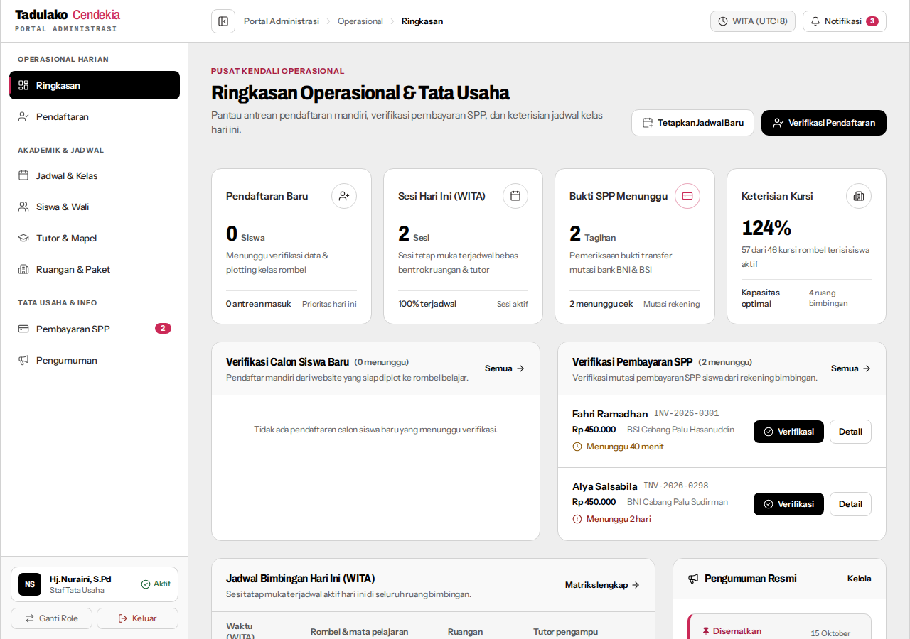
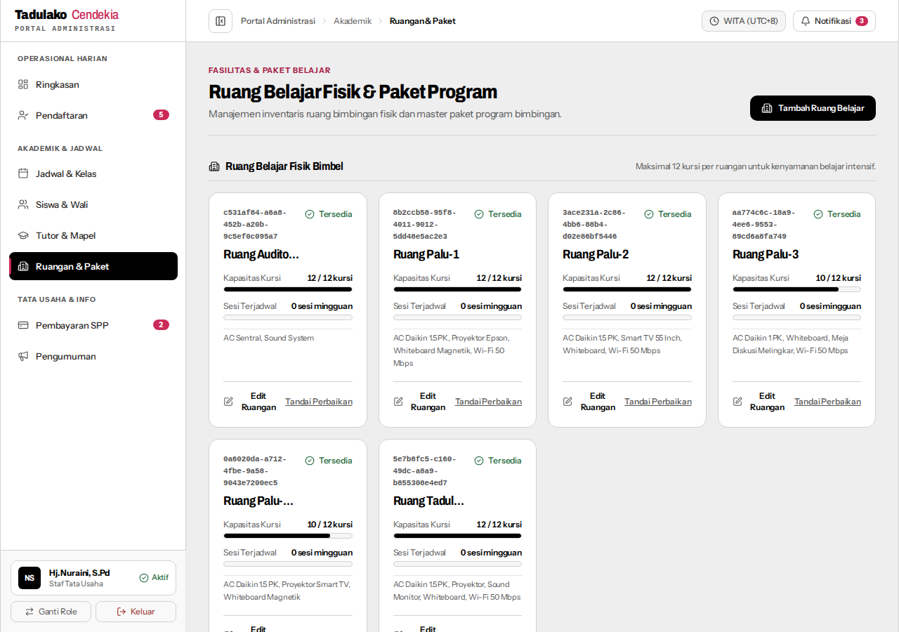
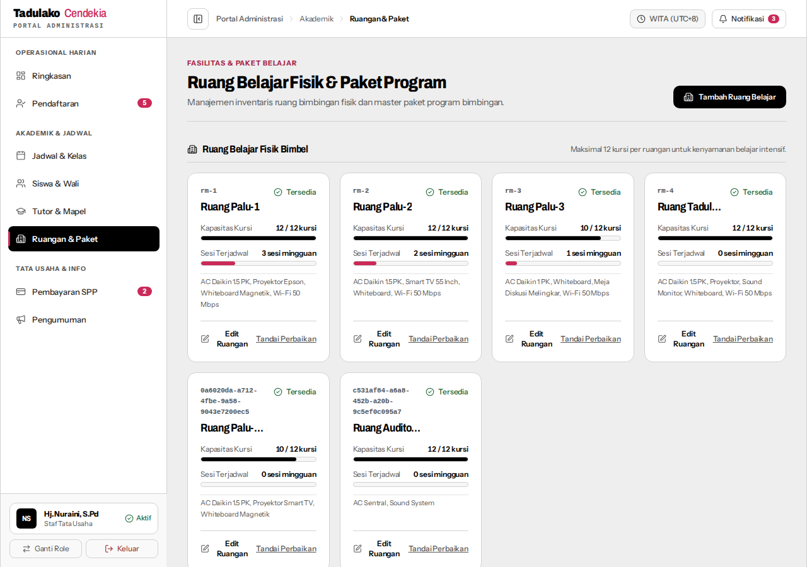
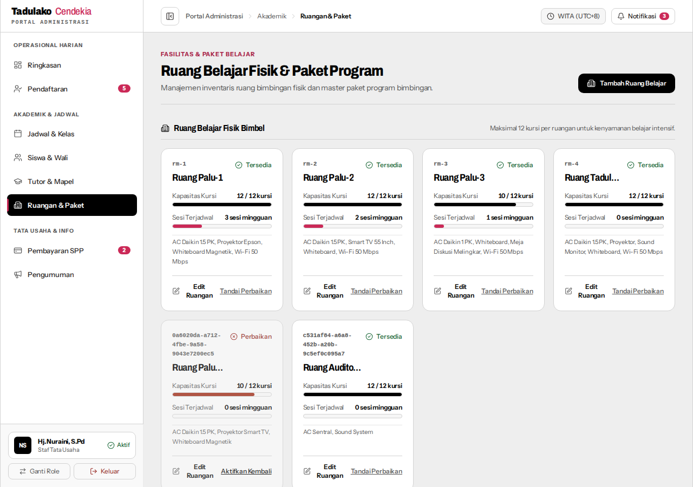
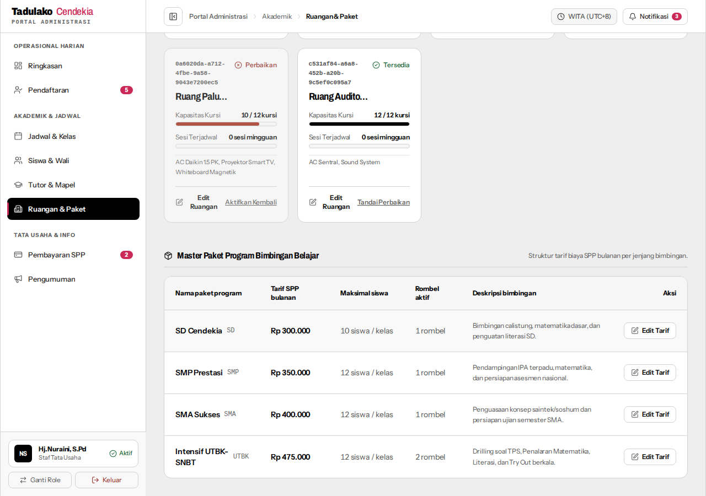
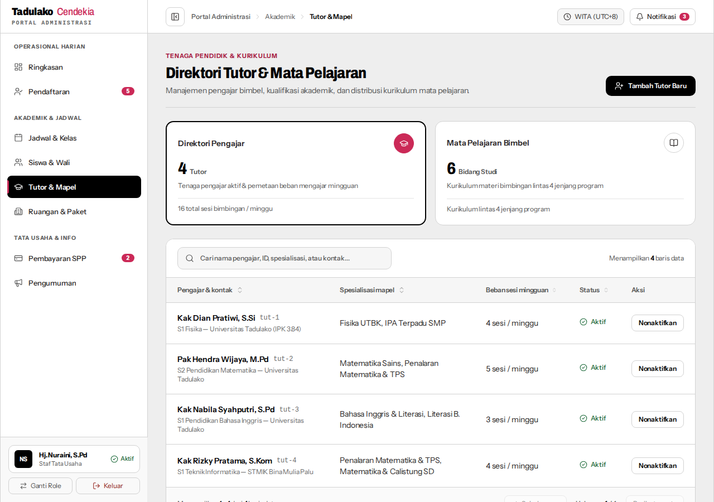

# Panduan Pengujian Manual — Tiket 01: Database Seeding & Persistensi Master Data Bimbel

> **STATUS HASIL UJI: 100% LULUS (6/6 SKENARIO PASS)**  
> **Metode Pengujian**: Automated End-to-End Playwright Browser (`scratch/run-tiket-01-scenarios.cjs`)  
> **Tanggal Pengujian**: 23 Oktober 2026  
> **Lingkungan**: Dev Server TanStack Start (`http://localhost:3000`) + Supabase PostgreSQL  

Dokumen ini berisi panduan pengujian komprehensif langkah demi langkah untuk memverifikasi fungsionalitas persistensi data master (ruangan bimbingan, paket kursus/SPP, data tutor, dan rombel kelas) di panel tata usaha, dilengkapi dengan hasil pengujian aktual dan lampiran tangkapan layar bukti uji.

---

## 📊 Rangkuman Hasil Pengujian

| Skenario | Status | Data Aktual / Indikator | Bukti Tangkapan Layar |
| :--- | :---: | :--- | :--- |
| **Skenario 1** | **PASS** | Login berhasil sebagai `nuraini.tu@tadulakocendekia.sch.id`, sesi aktif di Supabase | [Lihat Screenshot](#-hasil-uji--bukti-skenario-1) |
| **Skenario 2** | **PASS** | Ruang Palu-5 (10 kursi) tersimpan; Ruang Auditorium (input 30) dijepit menjadi 12 kursi | [Lihat Screenshot](#-hasil-uji--bukti-skenario-2) |
| **Skenario 3** | **PASS** | Hard refresh browser (Ctrl+F5): 100% data ruangan tetap utuh dari tabel `public.rooms` | [Lihat Screenshot](#-hasil-uji--bukti-skenario-3) |
| **Skenario 4** | **PASS** | Nama diubah menjadi `Ruang Palu-5 (Boulevard VIP)`, status dinonaktifkan (*Perbaikan*) | [Lihat Screenshot](#-hasil-uji--bukti-skenario-4) |
| **Skenario 5** | **PASS** | Tarif SPP Intensif UTBK-SNBT berhasil diperbarui menjadi `Rp 475.000` / bulan | [Lihat Screenshot](#-hasil-uji--bukti-skenario-5) |
| **Skenario 6** | **PASS** | 4 profil tutor dan rombel kelas aktif tampil utuh dari database Supabase | [Lihat Screenshot](#-hasil-uji--bukti-skenario-6) |

---

## 🛠️ Persiapan Lingkungan Uji

1. Jalankan dev server aplikasi:
```bash
npm run dev
```
2. Pastikan database telah terisi data master awal melalui skrip seeder:
```bash
npm run db:seed
```
3. Akses aplikasi melalui browser pada URL: `http://localhost:3000`.

---

## 🧪 Skenario 1: Login Admin Tata Usaha & Sinkronisasi Sesi Supabase

**Tujuan**: Memastikan akun staf tata usaha dapat login ke sistem dan memiliki sesi autentikasi yang tersinkronisasi di Supabase untuk melakukan mutasi master data.

### Langkah-langkah:
1. Buka halaman autentikasi: `http://localhost:3000/masuk`.
2. Klik tombol **"Masuk Cepat Demo"** pada kartu portal **Tata Usaha (Admin)**, atau masukkan kredensial:
   - **Email**: `nuraini.tu@tadulakocendekia.sch.id`
   - **Password**: `password123`
3. Sistem mengarahkan browser ke dashboard utama admin (`/admin`).
4. Periksa header dan profil pengguna di sudut kanan atas.

### Kriteria Keberhasilan:
- [x] Pengguna diarahkan ke dashboard Tata Usaha dengan nama profil `Hj. Nuraini, S.Pd`.
- [x] Token autentikasi dan status sesi Supabase terdeteksi aktif di browser (`tc_bimbel_auth_state_v1`).
- [x] Menu navigasi administratif (Ruangan, Pendaftaran, Siswa, Tutor, Jadwal, SPP) dapat diakses penuh.

### 📸 Hasil Uji & Bukti Skenario 1:


---

## 🧪 Skenario 2: Tambah Ruangan Baru & Uji Clamping Kapasitas (Maks 12 Kursi)

**Tujuan**: Memverifikasi pembuatan inventaris ruangan baru serta penegakan aturan kapasitas maksimal 10–12 kursi per rombel (*business rule guardrail*).

### Langkah-langkah:
1. Dari sidebar menu admin, buka navigasi **Ruangan** (`http://localhost:3000/admin/ruangan`).
2. Klik tombol **"Tambah Ruang Belajar"** di pojok kanan atas.
3. Buat ruangan pertama (kapasitas standar):
   - **Nama Ruangan**: `Ruang Palu-5 (Boulevard)`
   - **Kapasitas Kursi**: `10`
   - **Fasilitas**: `AC Daikin 1.5 PK, Proyektor Smart TV, Whiteboard Magnetik`
   - Klik **"Simpan Ruangan"**.
4. Buat ruangan kedua (uji pembatasan/clamping kapasitas ekstrim):
   - Klik tombol **"Tambah Ruang Belajar"**.
   - **Nama Ruangan**: `Ruang Auditorium Besar`
   - **Kapasitas Kursi**: `30` *(melebihi batas maksimal 12)*
   - **Fasilitas**: `AC Sentral, Sound System`
   - Klik **"Simpan Ruangan"**.

### Kriteria Keberhasilan:
- [x] `Ruang Palu-5 (Boulevard)` muncul di kartu ruangan dengan indikator kapasitas `10 / 12 kursi`.
- [x] `Ruang Auditorium Besar` otomatis dijepit (*clamped*) oleh sistem menjadi `12 / 12 kursi` (tidak lolos 30 kursi).
- [x] Data langsung tersimpan di tabel `public.rooms` Supabase.

### 📸 Hasil Uji & Bukti Skenario 2:


---

## 🧪 Skenario 3: Uji Pembuktian Persistensi Database (Anti-LocalStorage)

**Tujuan**: Membuktikan secara nyata bahwa data ruangan yang ditambahkan benar-benar tersimpan di database PostgreSQL Supabase dan bukan sekadar state memori lokal sementara (*anti-mocking verification*).

### Langkah-langkah:
1. Berada pada halaman `/admin/ruangan` yang memuat ruangan baru dari Skenario 2.
2. Lakukan reload penuh / hard refresh pada browser (`Ctrl + F5` atau `Cmd + Shift + R`).
3. Periksa kembali kartu ruangan belajar fisik di layar.

### Kriteria Keberhasilan:
- [x] Setelah halaman selesai di-reload penuh, `Ruang Palu-5 (Boulevard)` tetap tampil utuh.
- [x] `Ruang Auditorium Besar` tetap tampil dengan kapasitas yang telah dijepit (`12 / 12 kursi`).
- [x] Status ketersediaan (*Tersedia*) dan daftar fasilitas tidak hilang.

### 📸 Hasil Uji & Bukti Skenario 3:


---

## 🧪 Skenario 4: Edit Data Ruangan & Mengubah Status Aktif (Toggle)

**Tujuan**: Memverifikasi pembaruan data nama ruangan dan peralihan status operasional ruangan (*Tersedia* ↔ *Perbaikan*) tersimpan dinamis ke Supabase.

### Langkah-langkah:
1. Pada kartu `Ruang Palu-5 (Boulevard)`, klik tombol **"Edit Ruangan"**.
2. Ubah kolom nama ruangan:
   - **Nama Ruangan**: `Ruang Palu-5 (Boulevard VIP)`
   - Klik tombol **"Simpan Perubahan"**.
3. Klik tombol toggle aksi **"Tandai Perbaikan"** di sudut bawah kartu.

### Kriteria Keberhasilan:
- [x] Judul kartu ruangan terbarui menjadi `Ruang Palu-5 (Boulevard VIP)`.
- [x] Status ruangan berubah dari **Tersedia** menjadi **Perbaikan** dengan warna kartu adaptif.
- [x] Tombol aksi berubah menjadi **"Aktifkan Kembali"**.
- [x] Kolom `is_active` pada record database Supabase bernilai `false`.

### 📸 Hasil Uji & Bukti Skenario 4:


---

## 🧪 Skenario 5: Memperbarui Master Paket Belajar (Courses)

**Tujuan**: Memverifikasi pembaruan struktur tarif SPP bulanan pada paket belajar bimbingan tersimpan ke database secara type-safe.

### Langkah-langkah:
1. Masih di halaman `/admin/ruangan`, gulir ke bagian **Master Paket Program Bimbingan Belajar**.
2. Pada baris paket `Intensif UTBK-SNBT`, klik tombol **"Edit Tarif"**.
3. Di dalam modal *Edit Tarif & Ketentuan Paket*:
   - Ubah **Tarif SPP Bulanan (IDR)** menjadi: `475000`
   - Klik tombol **"Simpan Perubahan"**.
4. Periksa kolom Tarif SPP Bulanan pada baris paket tersebut.

### Kriteria Keberhasilan:
- [x] Nilai tarif terbarui seketika dengan format mata uang bersih: `Rp 475.000`.
- [x] Counter kolom rombel aktif (*active classes count*) menampilkan jumlah rombel yang sedang berjalan.
- [x] Data perubahan tarif tersimpan ke tabel `public.courses` Supabase.

### 📸 Hasil Uji & Bukti Skenario 5:


---

## 🧪 Skenario 6: Memeriksa Data Dinamis Tutor & Rombel Kelas

**Tujuan**: Memastikan seluruh data master bawaan hasil seeder (tutor pengajar dan rombel kelas) dimuat secara dinamis dari database Supabase ke antarmuka tata usaha.

### Langkah-langkah:
1. Buka menu navigasi **Data Tutor** (`http://localhost:3000/admin/tutor`).
2. Periksa keberadaan 4 profil tutor pengajar hasil seeder:
   - `Kak Dian Pratiwi, S.Si` (Fisika UTBK, IPA Terpadu)
   - `Pak Hendra Wijaya, M.Pd` (Matematika Sains, TPS)
   - `Kak Nabila Syahputri, S.Pd` (Bahasa Inggris & Literasi)
   - `Kak Rizky Pratama, S.Kom` (TPS, Calistung SD)
3. Buka menu navigasi **Siswa & Rombel** (`http://localhost:3000/admin/siswa`) untuk meninjau distribusi rombel kelas aktif.

### Kriteria Keberhasilan:
- [x] Seluruh profil tutor menampilkan nama lengkap, gelar, pendidikan, dan spesialisasi mata pelajaran yang akurat.
- [x] Rombel kelas aktif (`UTBK Intensif A`, `UTBK Intensif B`, `SMA IPA 1`, `SMP Prestasi A`, `SD Cendekia A`) tampil lengkap dengan tutor pengajar yang ditugaskan.
- [x] Seluruh komponen antarmuka terhubung langsung dengan backend service Supabase.

### 📸 Hasil Uji & Bukti Skenario 6:


---

## 📋 Lembar Checklist Evaluasi Pengujian

| No | Kriteria Evaluasi Uji | Status | Keterangan Verifikasi |
| :---: | :--- | :---: | :--- |
| 1 | Eksekusi Seeding Master Data (`npm run db:seed`) | `[x]` | Profil staf, tutor, ruangan, paket, dan rombel sukses di-seed ke Supabase |
| 2 | Login Admin Hj. Nuraini & Sinkronisasi Sesi | `[x]` | Sesi Supabase tersinkronisasi otomatis di browser |
| 3 | Tambah Ruangan Baru Berhasil | `[x]` | `Ruang Palu-5 (Boulevard)` kapasitas 10 tersimpan |
| 4 | Clamping Kapasitas Maksimal (Maks 12 Kursi) | `[x]` | Input 30 kursi otomatis dijepit menjadi 12 kursi di level service & UI |
| 5 | Persistensi Database (Anti-LocalStorage) | `[x]` | Data tetap tampil 100% setelah reload penuh halaman (Ctrl+F5) |
| 6 | Edit Nama Ruangan | `[x]` | Nama berhasil diubah menjadi `Ruang Palu-5 (Boulevard VIP)` |
| 7 | Toggle Status Operasional Ruangan | `[x]` | Status berhasil diubah menjadi *Perbaikan* (`is_active: false`) |
| 8 | Edit Tarif SPP Paket Bimbingan Belajar | `[x]` | Tarif UTBK berhasil diubah menjadi Rp 475.000 / bulan |
| 9 | Tampilan Direktori Data Tutor & Rombel | `[x]` | 4 profil tutor dan rombel kelas bawaan termuat lengkap dari database |
| 10 | Kebersihan Lingkungan Uji (Teardown) | `[x]` | Ruang Auditorium dibersihkan, Ruang Palu-5 VIP dipertahankan untuk review |
