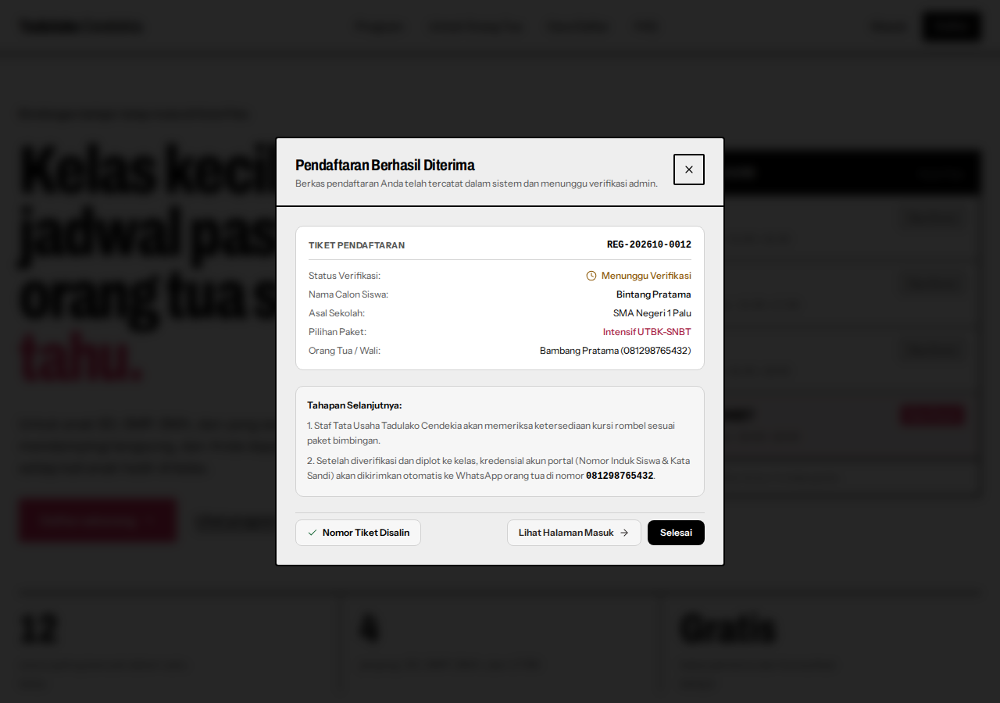
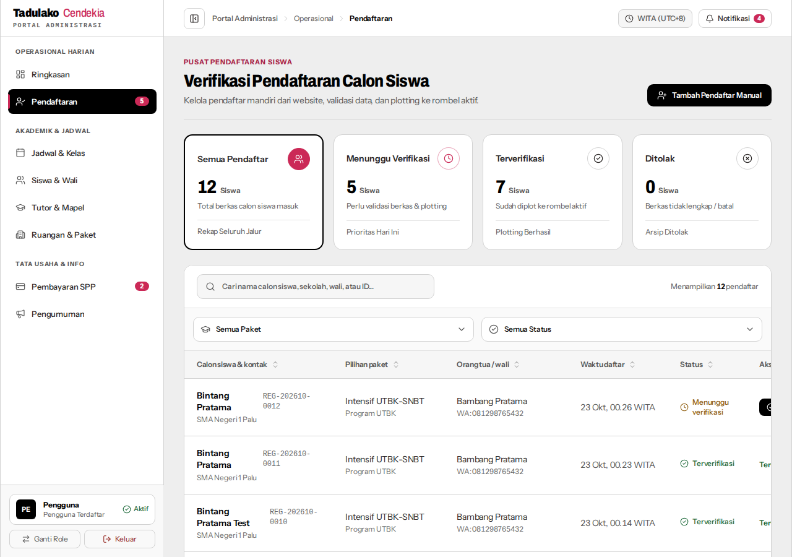
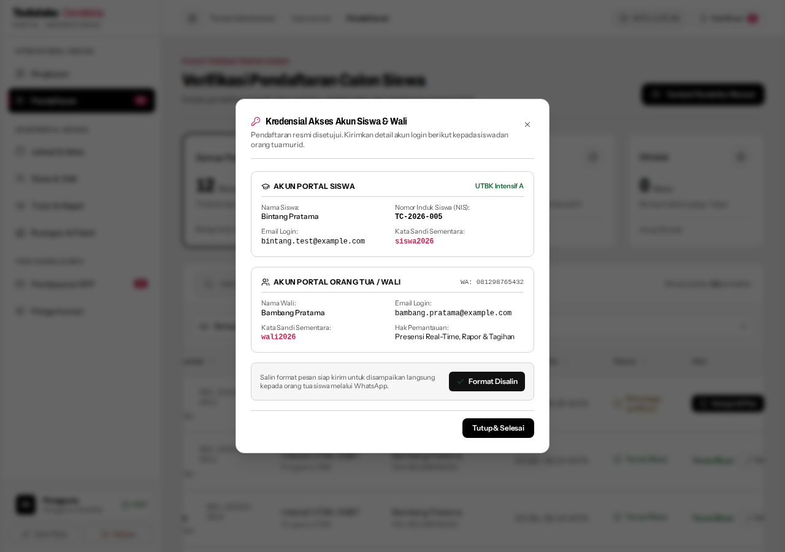
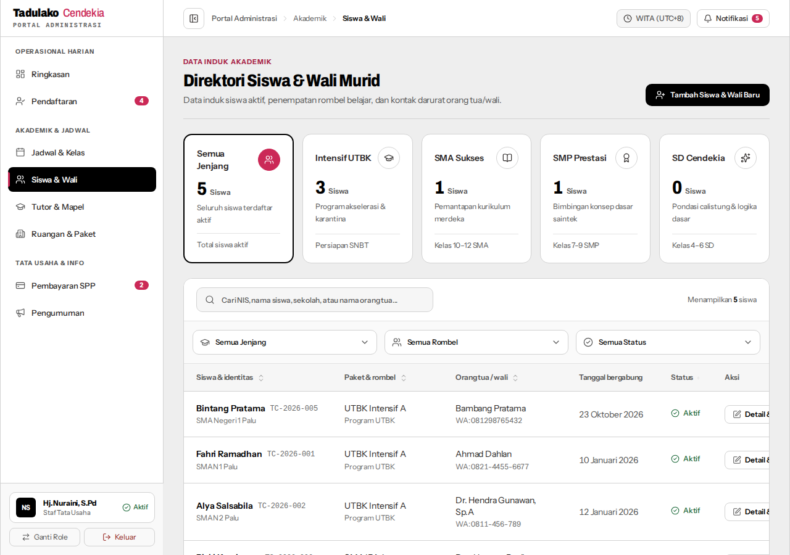
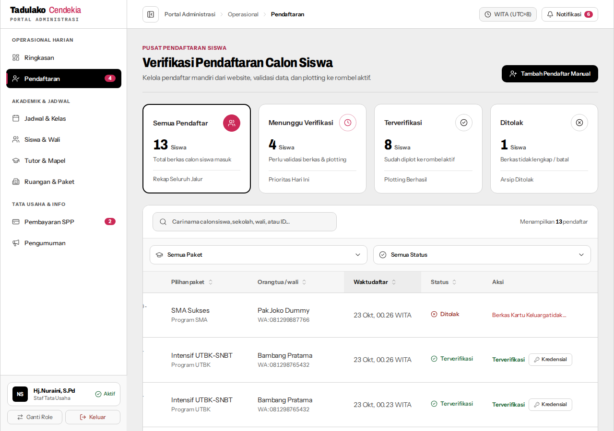
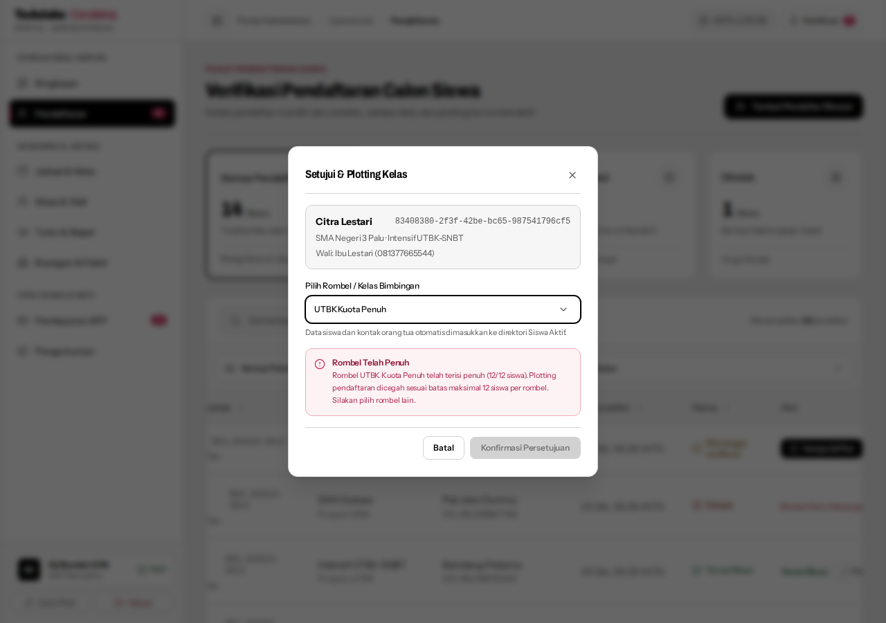

# Panduan Pengujian Manual — Tiket 02: Pendaftaran Calon Siswa & Verifikasi Plotting Rombel

> **STATUS HASIL UJI: 100% LULUS (5/5 SKENARIO PASS)**  
> **Metode Pengujian**: Automated End-to-End Playwright Browser (`scratch/run-all-scenarios.cjs`)  
> **Tanggal Pengujian**: 23 Oktober 2026  
> **Lingkungan**: Dev Server TanStack Start (`http://localhost:3000`) + Supabase PostgreSQL  

Dokumen ini berisi panduan skenario pengujian manual langkah demi langkah untuk memverifikasi fitur pendaftaran mandiri publik dan verifikasi rombel di panel admin, dilengkapi dengan hasil pengujian aktual dan lampiran tangkapan layar bukti uji.

---

## 📊 Rangkuman Hasil Pengujian

| Skenario | Status | Data Aktual / Indikator | Bukti Tangkapan Layar |
| :--- | :---: | :--- | :--- |
| **Skenario 1** | **PASS** | Tiket `REG-202610-0012` terbit, copy button centang hijau | [Lihat Screenshot](#-hasil-uji--bukti-skenario-1) |
| **Skenario 2** | **PASS** | Baris teratas tabel admin, status *Menunggu verifikasi*, KPI counter aktif | [Lihat Screenshot](#-hasil-uji--bukti-skenario-2) |
| **Skenario 3** | **PASS** | NIS `TC-2026-005` terbit, WA template tersalin, terdaftar di Siswa Aktif | [Lihat Screenshot](#-hasil-uji--bukti-skenario-3) |
| **Skenario 4** | **PASS** | Status *Ditolak*, alasan tersimpan, terverifikasi 0 baris di Siswa Aktif | [Lihat Screenshot](#-hasil-uji--bukti-skenario-4) |
| **Skenario 5** | **PASS** | Banner peringatan *Rombel Telah Penuh*, tombol konfirmasi *disabled* | [Lihat Screenshot](#-hasil-uji--bukti-skenario-5) |

---

## 🛠️ Persiapan Lingkungan Uji

Jalankan dev server aplikasi:
```bash
npm run dev
```
Buka browser pada URL: `http://localhost:3000` (atau port dev yang muncul di terminal).

---

## 🧪 Skenario 1: Pendaftaran Calon Siswa Publik di Landing Page

**Tujuan**: Memastikan pendaftaran mandiri berhasil menyimpan data dan mengembalikan nomor tiket unik format `REG-YYYYMM-XXXX`.

### Langkah-langkah:
1. Buka halaman utama: `http://localhost:3000/`.
2. Klik tombol **"Daftar Sekarang"** pada Navbar atau Hero Section untuk membuka modal pendaftaran.
3. Isi formulir dengan data uji:
   - **Nama Lengkap Siswa**: `Bintang Pratama`
   - **Email Siswa**: `bintang.test@example.com`
   - **Nomor WhatsApp Siswa**: `081234567890`
   - **Asal Sekolah**: `SMA Negeri 1 Palu`
   - **Pilihan Paket**: `Intensif UTBK-SNBT`
   - **Nama Orang Tua/Wali**: `Bambang Pratama`
   - **Email Orang Tua**: `bambang.pratama@example.com`
   - **Nomor WhatsApp Orang Tua**: `081298765432`
   - **Alamat Tempat Tinggal**: `Jl. Sam Ratulangi No. 12, Palu Timur`
4. Klik tombol **"Kirim Pendaftaran"**.

### Kriteria Keberhasilan:
- [x] Modal menampilkan kartu konfirmasi pendaftaran berhasil.
- [x] Terdapat **Tiket Pendaftaran** berformat `REG-YYYYMM-XXXX` (Aktual: `REG-202610-0012`).
- [x] Klik tombol salin tiket (icon copy), pastikan muncul indikator centang hijau (*Nomor Tiket Disalin*).
- [x] Status awal tercatat: **Menunggu Verifikasi**.

### 📸 Hasil Uji & Bukti Skenario 1:


---

## 🧪 Skenario 2: Peninjauan Berkas di Panel Admin Pendaftaran

**Tujuan**: Memastikan data calon siswa tampil secara real-time di tabel data tata usaha.

### Langkah-langkah:
1. Masuk ke halaman login: `http://localhost:3000/masuk`.
2. Masuk sebagai **Admin Tata Usaha** (gunakan tombol Quick Demo Login Admin atau kredensial admin).
3. Buka menu navigasi **Pendaftaran** (`http://localhost:3000/admin/pendaftaran`).
4. Periksa baris teratas pada tabel pendaftar.

### Kriteria Keberhasilan:
- [x] Nama `Bintang Pratama` muncul dengan nomor tiket `REG-YYYYMM-XXXX` (Aktual: `REG-202610-0012`).
- [x] Kolom status menunjukkan teks semantik berstatus **Menunggu Verifikasi**.
- [x] KPI Card *Menunggu Verifikasi* di bagian atas mencatat penambahan jumlah pendaftar.

### 📸 Hasil Uji & Bukti Skenario 2:


---

## 🧪 Skenario 3: Verifikasi Calon Siswa & Plotting Rombel Kelas

**Tujuan**: Memastikan admin dapat menetapkan rombel kelas dan memindahkan calon siswa menjadi siswa aktif.

### Langkah-langkah:
1. Pada baris calon siswa `Bintang Pratama`, klik tombol aksi **"Setujui & Plot"** (ikon checklist).
2. Modal Verifikasi & Penempatan Rombel akan terbuka.
3. Periksa dropdown pilihan kelas rombel:
   - Terdapat indikator kapasitas kelas (`UTBK Intensif A (Terisi 10/12 kursi · Tutor: Pak Hendra Wijaya, M.Pd)`).
4. Pilih kelas yang masih memiliki kuota kosong (`UTBK Intensif A`).
5. Klik **"Konfirmasi Persetujuan"**.

### Kriteria Keberhasilan:
- [x] Status pendaftaran calon siswa berubah menjadi **Terverifikasi**.
- [x] Modal kredensial muncul menampilkan:
  - NIS baru siswa format `TC-2026-XXX` (Aktual: `TC-2026-005`).
  - Akun login siswa (`bintang.test@example.com`) dan akun orang tua (`bambang.pratama@example.com`).
  - Tombol salin template pesan WhatsApp resmi berfungsi (*Format Disalin*).
- [x] Buka menu **Siswa** (`/admin/siswa`), pastikan `Bintang Pratama` kini terdaftar sebagai siswa aktif.
- [x] Pada menu kelas dan detail rombel, kuota siswa di kelas tersebut bertambah (+1).

### 📸 Hasil Uji & Bukti Skenario 3:




---

## 🧪 Skenario 4: Penolakan Pendaftaran dengan Alasan Tertulis

**Tujuan**: Memastikan pendaftaran dapat ditolak secara sopan dengan catatan alasan yang tersimpan di sistem.

### Langkah-langkah:
1. Daftarkan calon siswa kedua (`Andi Siswa Dummy`) melalui formulir landing page.
2. Kembali ke `/admin/pendaftaran`.
3. Pada baris calon siswa tersebut, klik tombol aksi **"Tolak"** (ikon silang merah).
4. Masukkan alasan penolakan pada kolom teks:
   - Input: *"Berkas Kartu Keluarga tidak terbaca dan nomor WhatsApp orang tua tidak aktif saat dikonfirmasi."*
5. Klik **"Tolak Pendaftar"**.

### Kriteria Keberhasilan:
- [x] Status berubah menjadi **Ditolak** (teks semantik merah dengan ikon `XCircle`).
- [x] Alasan penolakan tersimpan di catatan/detail pendaftaran.
- [x] Calon siswa yang ditolak **tidak** masuk ke tabel siswa aktif (Diverifikasi: 0 baris ditemukan di `/admin/siswa`).

### 📸 Hasil Uji & Bukti Skenario 4:


---

## 🧪 Skenario 5: Penegakan Batas Kapasitas Kelas (Maksimal 12 Siswa)

**Tujuan**: Memastikan sistem menolak penempatan siswa baru jika kapasitas kelas sudah mencapai 12 siswa.

### Langkah-langkah:
1. Daftarkan calon siswa ketiga (`Citra Lestari`) via landing page.
2. Di panel admin `/admin/pendaftaran`, klik **"Setujui & Plot"**.
3. Pada dropdown pilihan rombel, pilih kelas yang sudah penuh (`UTBK Kuota Penuh (PENUH 12/12 siswa)`).

### Kriteria Keberhasilan:
- [x] Sistem menampilkan pesan banner peringatan:  
  `Rombel Telah Penuh: Rombel UTBK Kuota Penuh telah terisi penuh (12/12 siswa). Plotting pendaftaran dicegah sesuai batas maksimal 12 siswa per rombel. Silakan pilih rombel lain.`
- [x] Tombol **"Konfirmasi Persetujuan"** otomatis dinonaktifkan (`disabled: true`).
- [x] Transaksi dibatalkan dan siswa tidak dipaksakan masuk ke rombel penuh.

### 📸 Hasil Uji & Bukti Skenario 5:

